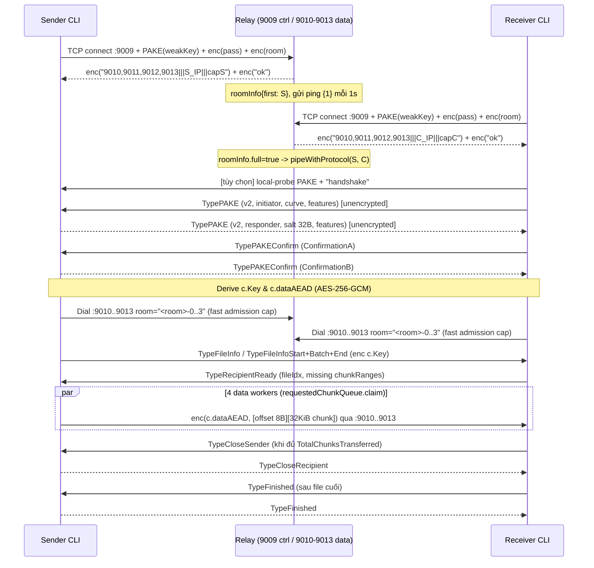

# Phân tích Codebase & Truy vết Luồng Thực thi Hiện tại

> Hoàn thành Bước 1–4 của `/plan`: Khảo sát cấu trúc repository, truy vết luồng thực thi từ đầu đến cuối, liệt kê các file/struct/hàm liên quan, và nhận diện bẫy kỹ thuật & vấn đề tương thích.

---

## 1. Cấu trúc Repository liên quan

Module: `github.com/schollz/croc/v11` (Go `1.27.3`, HEAD `67e2b110`).

| Tầng | File chính | Vai trò hiện tại |
|---|---|---|
| **CLI & Flags** | [cli.go](file:///Users/huyle/Documents/dev/LTM/croc/croc/src/cli/cli.go) | Khai báo lệnh `send`, `receive` (default action), `relay`; map flag sang `croc.Options` và các `tcp.With*` option; xử lý `--remember`. |
| **Transport & Framing** | [comm.go](file:///Users/huyle/Documents/dev/LTM/croc/croc/src/comm/comm.go) | Quay số TCP/SOCKS5/HTTP CONNECT (`NewConnectionContext`); đóng khung `"croc" + uint32 LE len + body` (trần `64 MiB`). |
| **Relay Server** | [tcp.go](file:///Users/huyle/Documents/dev/LTM/croc/croc/src/tcp/tcp.go), [options.go](file:///Users/huyle/Documents/dev/LTM/croc/croc/src/tcp/options.go), [defaults.go](file:///Users/huyle/Documents/dev/LTM/croc/croc/src/tcp/defaults.go), [capability.go](file:///Users/huyle/Documents/dev/LTM/croc/croc/src/tcp/capability.go), [admission.go](file:///Users/huyle/Documents/dev/LTM/croc/croc/src/tcp/admission.go), [pending_handshakes.go](file:///Users/huyle/Documents/dev/LTM/croc/croc/src/tcp/pending_handshakes.go), [ctx.go](file:///Users/huyle/Documents/dev/LTM/croc/croc/src/tcp/ctx.go) | Mỗi port chạy 1 `server` độc lập; PAKE relay với `weakKey=[1,2,3]` + mật khẩu relay; `roomInfo{first, second}` chỉ nhận đúng 2 peer; ghép đôi xong gọi `pipeWithProtocol` (`io.Copy` 2 chiều không buffer). |
| **WebSocket Bridge mẫu** | [webrelay.go](file:///Users/huyle/Documents/dev/LTM/croc/croc/src/webrelay/webrelay.go#L329-L394) | Bridge `/ws?relay=&port=` nối `websocket.NetConn` ↔ TCP relay (chỉ nằm trong binary `croc-web`, chưa có trong `croc relay` và client CLI chưa dial WS). |
| **Client cốt lõi** | [croc.go](file:///Users/huyle/Documents/dev/LTM/croc/croc/src/croc/croc.go), [client_state.go](file:///Users/huyle/Documents/dev/LTM/croc/croc/src/croc/client_state.go), [relay_dial.go](file:///Users/huyle/Documents/dev/LTM/croc/croc/src/croc/relay_dial.go), [local_relay.go](file:///Users/huyle/Documents/dev/LTM/croc/croc/src/croc/local_relay.go), [chunk_queue.go](file:///Users/huyle/Documents/dev/LTM/croc/croc/src/croc/chunk_queue.go), [receive_preflight.go](file:///Users/huyle/Documents/dev/LTM/croc/croc/src/croc/receive_preflight.go), [staged_transport.go](file:///Users/huyle/Documents/dev/LTM/croc/croc/src/croc/staged_transport.go), [tailcat_negotiation.go](file:///Users/huyle/Documents/dev/LTM/croc/croc/src/croc/tailcat_negotiation.go), [bundle.go](file:///Users/huyle/Documents/dev/LTM/croc/croc/src/croc/bundle.go) | Quản lý vòng đời `Send()` / `Receive()`, PAKE peer, mở kênh dữ liệu, hàng đợi chunk, nhận & ghi file, reconnect/resume. |
| **Thông điệp & Mã hoá** | [message.go](file:///Users/huyle/Documents/dev/LTM/croc/croc/src/message/message.go), [pakekey.go](file:///Users/huyle/Documents/dev/LTM/croc/croc/src/pakekey/pakekey.go), [crypt.go](file:///Users/huyle/Documents/dev/LTM/croc/croc/src/crypt/crypt.go) | `Message` JSON + DEFLATE + AES-256-GCM; PAKE v2 identity-bound HKDF; AEAD in-place cho data chunk. |
| **Tiện ích Resume & Hash** | [utils.go](file:///Users/huyle/Documents/dev/LTM/croc/croc/src/utils/utils.go#L443-L590) | `MissingChunks` (quét block toàn byte `0`), `ChunkRangesCount`, `ChunkRangesBytes`, `HashFileCtx`. |
| **Kiểm thử E2E sẵn có** | [croc_test.go](file:///Users/huyle/Documents/dev/LTM/croc/croc/src/croc/croc_test.go#L2051-L2135), [tcp_test.go](file:///Users/huyle/Documents/dev/LTM/croc/croc/src/tcp/tcp_test.go) | Helper `startTestRelay(t, dataPorts)` dựng relay thật trên cổng ngẫu nhiên. |

---

## 2. Truy vết luồng thực thi hiện tại (1-to-1 qua Relay)

### Chi tiết từng bước trong mã nguồn
1. **Relay handshake (`src/tcp/tcp.go:433-665`)**:
   - `clientHandshake`: kiểm tra `"ping"` → trả `"pong"`; kiểm tra `croc-fast-admission-v1:` → xác thực HMAC không cần PAKE; ngược lại chạy PAKE với `weakKey=[1,2,3]` trên curve `siec`, xác thực `s.password`, thử đọc `earlyRoom` trong **5 ms**, trả chuỗi `banner + "|||" + remoteAddr [+ "|||" + capability]`.
   - `clientCommunication`: kiểm tra `admissionLimits.allow`, gọi `admitToRoom`:
     - Phòng mới → tạo `roomInfo{first: c}`, trả `"ok"`, vào vòng lặp gửi `[]byte{1}` mỗi 1 s (`tcp.go:340-376`).
     - Phòng có 1 peer → gán `second: c`, `full: true`, trả `"ok"`, gọi `pipeWithProtocol` (`io.Copy` 2 chiều), kết thúc thì `deleteRoom`.
     - Phòng đã `full` → trả `"room full"` (`tcp.go:625-632`).
2. **Sender (`src/croc/croc.go:1787-1921`)**:
   - `Send()` khởi chạy song song local relay (nếu không `--no-local`) và goroutine kết nối control tới relay qua `connectRelayControl`.
   - Lưu `c.Options.RelayPorts = strings.Split(route.banner, ",")`, `c.setConnection(0, route.connection)`.
   - Vào `transferWithReconnect` → `transfer()` (`croc.go:2261`), đọc từng frame control chuyển vào `processMessage` (`croc.go:3063`).
3. **Mở kênh data (`src/croc/croc.go:2916-2996`)**:
   - Sau `processMessagePakeConfirm` → `activateSecureChannel` (`tailcat_negotiation.go:186`): nếu dùng relay, gọi `activateRelayDataChannels` → `openRelayDataChannels`.
   - **Giới hạn hiện tại**: Chỉ lấy **1 host duy nhất** (`relayHost`) từ `c.currentRelayControlRoute()`, lặp `j = 0..min(len(RelayPorts), 8)-1`, mở phòng `<RoomName>-<j>` trên cổng `RelayPorts[j]`, cài vào `c.conn[j+1]`.
4. **Truyền & nhận chunk (`src/croc/chunk_queue.go`, `src/croc/croc.go:3660-3948`)**:
   - Kích thước 1 chunk: `models.TCP_BUFFER_SIZE / 2` = **32,768 bytes (32 KiB)** (`models/constants.go:16`).
   - Sender (`sendData`, `croc.go:3852`): mỗi worker lấy `readingPos` từ `requestedChunkQueue.claim()`, đọc file bằng `ReadAt`, gắn header `uint64 LE offset` (8 byte), nén nếu file bật nén, mã hoá bằng `crypt.EncryptAEADTo(..., c.dataAEAD)`, gửi `dataConn.Send(...)`, rồi **gọi ngay `queue.complete()` mà KHÔNG có ACK từ receiver**.
   - Receiver (`receiveData`, `croc.go:3660`): giải mã `DecryptAEADInPlace`, giải nén, tách `position` 8 byte đầu, kiểm tra biên `chunkFits`, ghi bất đồng bộ `receiveFile.WriteAt(data[8:], positionInt64)`, tăng `c.TotalChunksTransferred++` và `c.TotalSent += len`. Khi đủ số chunk → đóng file và gửi `TypeCloseSender`.
5. **Xử lý lỗi & Reconnect hiện tại (`src/croc/croc.go:712-857`)**:
   - Bất kỳ 1 data socket nào gặp lỗi đọc/ghi → gọi `attempt.report(transferDisconnectError)` → **huỷ toàn bộ attempt**, đóng tất cả kết nối, đợi backoff, kết nối lại vào `c.nextReconnectRoom`, chạy lại PAKE từ đầu, receiver gọi `utils.MissingChunks` để xin gửi lại các chunk còn toàn byte `0`.

---

## 3. Các giới hạn cứng, bẫy kỹ thuật & vấn đề tương thích đã phát hiện

| # | Phát hiện (vị trí mã nguồn) | Tác động đến tính năng mới | Cách xử lý trong kế hoạch |
|---|---|---|---|
| **1** | **`receiveData` KHÔNG chống trùng lặp chunk** (`croc.go:3777-3780`: `c.TotalChunksTransferred++` không kiểm tra offset đã nhận chưa) | Khi failover dual-relay gửi lại chunk đang in-flight, nếu chunk đó đã kịp tới receiver qua relay cũ thì receiver **đếm đúp**, đóng file sớm khi vẫn còn chunk thiếu ⇒ **file hỏng**! | Thêm `receivedBitmap` (1 bit/chunk; file 10 GiB chỉ tốn 40 KiB RAM) ở receiver để đảm bảo idempotent + sinh `TypeChunkAck` chính xác. |
| **2** | **`sendData` không theo dõi in-flight chunk và kill toàn bộ phiên khi 1 socket lỗi** (`croc.go:3920-3924`) | Nếu Relay B chết giữa chừng, cơ chế hiện tại lập tức báo `attempt.report` huỷ cả Relay A và ép reconnect! | Thay bằng `reliableChunkScheduler` theo dõi tập in-flight theo `relayID`; lỗi ở 1 relay chỉ `requeueRelay(relayID)` và tiếp tục trên relay còn lại nếu vẫn còn ≥ 1 relay sống. |
| **3** | **Banner response format `"|||"`** (`tcp.go:548-553`, `tcp.go:1044-1049`, `web/src/protocol/relay.ts:85-90`) | `parts[0]` là data ports, `parts[1]` là IP, `parts[2]` là fast-admission capability. Nếu chèn metadata vào `parts[0]` hoặc `parts[2]` sẽ phá vỡ client cũ. | Đặt metadata mở rộng ở **`parts[3]`** với tiền tố `"meta-v1:"` (nếu không có capability thì `parts[2] = ""`). Chỉ phát `parts[3]` khi relay bật `--peers` hoặc `--fanout` ⇒ tương thích ngược 100%. |
| **4** | **`websocket.NetConn` đóng kết nối khi `SetReadDeadline` hết hạn** (`coder/websocket`, xung đột với `earlyRoom` 5 ms tại `tcp.go:522`) | Nếu `tcp.server` đọc trực tiếp từ `websocket.NetConn`, client không pipelining sẽ bị ngắt ngay sau 5 ms. | Relay chạy WS endpoint như **in-process WS→loopback TCP bridge** (mẫu `webrelay.go`); client dùng `streamCtx` tách khỏi `dialCtx` + gửi WebSocket Ping mỗi 30 s. |
| **5** | **`utils.MissingChunks` kiểm tra block toàn byte `0` trực tiếp trên file đích** (`utils.go:443-505`) | Người dùng muốn receiver bị kick lưu file `.partial` và resume bằng phiên 1-1 sau đó. Ngoài ra, file gốc có block hợp lệ toàn `0` có thể bị tính sai phần trăm hoặc quét lại. | Ghi file đang nhận vào `<file>.partial` kèm sidecar bitmap `<file>.partial.crocmap`; chỉ rename thành `<file>` sau khi nhận đủ và khớp hash. Mở rộng `preflightReceiveFile` + `recipientInitializeFile` để phiên 1-1 tự phát hiện `.partial` + `.crocmap` và resume chính xác 100% (vẫn giữ tương thích khi resume file cũ không có `.partial`). |
| **6** | **Tailcat/DERP tự bật cho file $\ge 128\text{ MiB}$** (`tailcat_negotiation.go:26`) và **Small-file Bundle** (`bundle.go:283`) | Sẽ bỏ qua relay data channels hoặc dùng khung bundle không tương thích với dual-relay/fan-out. | Tự động ép `TransportRelay` và tắt `bundleSessionEligible()` khi Dual-Relay hoặc Fan-out đang bật. |
| **7** | **Giới hạn 8 data channel (`croc.go:2917`, `capability.go:53`) và `c.conn` 16 phần tử (`croc.go:457`)** | Với 2 relay × 4 data port = 8 data channel vừa đủ `c.conn[1..8]`; nếu muốn > 8 (vd 2×4 + standby control) cần quản lý slice động thay vì index cứng `j+1`. | Tách danh sách data connection theo `relayID` (`[]relayDataConn`), không phụ thuộc chỉ số cố định `1..8`. |
| **8** | **Giới hạn `sourceJoinLimit = 30` & `roomJoinLimit = 30` / phút** (`tcp/defaults.go:14-16`) | Trong benchmark Docker / localhost (mọi receiver cùng NAT IP hoặc `127.0.0.1`), 8 receiver × 5 port = 40 lượt join/phút sẽ chạm `sourceJoinLimit=30`! | Ghi nhận rõ cấu hình flag `--source-join-limit` / `--room-join-limit` cho relay khi test nhiều receiver cùng IP, và với fan-out dùng 1 control + 1–4 data port hợp lý. |
| **9** | **Fast-admission token gắn theo `Source` IP và `Parent` room** (`capability.go:129`) | Relay B là process khác nên có `RelayCapabilitySet` khác; token của Relay A không dùng được cho Relay B. | Mỗi relay giữ cặp `(relayAddress, relayCapability)` riêng biệt. |
| **10** | **Nút cổ chai uplink ở Mode (b)** | Khi Relay A chạy ngay trên máy sender, cả luồng Relay A→Receiver và luồng Sender→Relay B cùng tiêu thụ chung băng thông upload của máy sender. | Ghi rõ trong báo cáo & thiết kế benchmark tách biệt 2 kịch bản: (1) nút cổ chai tại relay/link trung gian (dual-relay tăng tốc rõ rệt), (2) nút cổ chai tại uplink sender (không tăng quá trần uplink, nhưng vẫn có giá trị failover/redundancy). |
