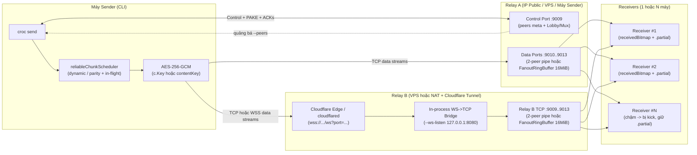
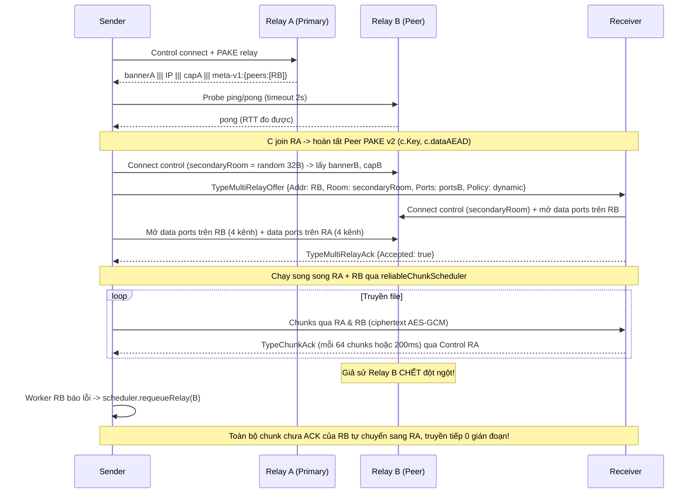
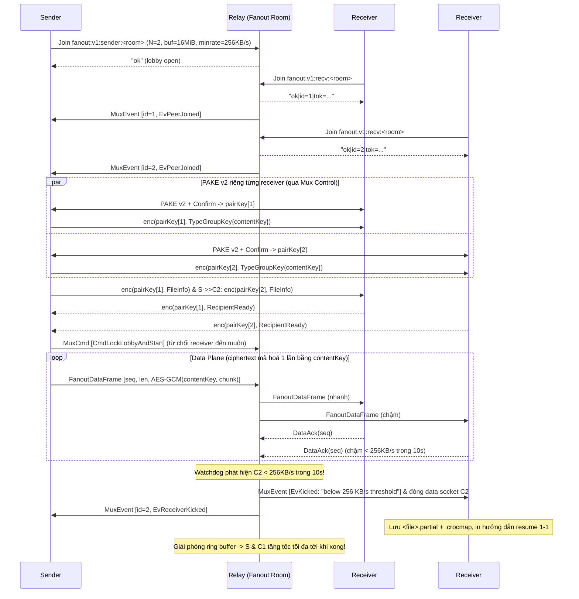

# Kế hoạch Triển khai Chi tiết: Dual-Relay Parallel Transfer & Bounded-Buffer 1-to-N Fan-out cho `croc` CLI

> Trạng thái: **CHỜ PHÊ DUYỆT** (chưa sửa đổi mã nguồn nào).  
> Phạm vi: **CLI (`croc` + `croc relay`)**; Web app để giai đoạn sau.  
> Tương thích ngược: **100%** với `croc v11` và `croc-web` hiện hành (tất cả tính năng mới là opt-in).  
> Tài liệu liên quan: [01_official_research.md](file:///Users/huyle/Documents/dev/LTM/croc/croc/multiple_croc_agent_doc/01_official_research.md), [02_codebase_analysis.md](file:///Users/huyle/Documents/dev/LTM/croc/croc/multiple_croc_agent_doc/02_codebase_analysis.md).

---

## 1. Tổng quan Kiến trúc & Mục tiêu

Dự án bổ sung hai tính năng lớn vào `croc` CLI theo kiến trúc module hoá để **cài đặt & kiểm thử độc lập từng phần trước**, sau đó **kết hợp thành 1 Sender → N Receivers qua 2 Relays**:

1. **Phần 1 – Dual-Relay Parallel Transfer + WebSocket Transport (Cloudflare Free)**:
   - Hỗ trợ **2 mô hình deploy**:
     - **Mode (a)**: 2 relay trên 2 máy/VPS IP public khác nhau (`hostA:9009`, `hostB:9009`).
     - **Mode (b)**: Máy sender chạy Relay A (IP public / port-forward), Relay B nằm sau NAT và expose qua **Cloudflare Tunnel (Quick/Named) dùng WebSocket (`wss://.../ws?port=...`)** — receiver không cần cài `cloudflared`.
   - **Relay biết nhau**: cấu hình tĩnh bằng `--peers`, quảng bá trong phần thứ 4 của banner response (`parts[3]`, tiền tố `meta-v1:`). Sender tự probe ping/pong các peer; nếu tìm thấy peer sẵn sàng và receiver kết nối được thì chạy **2 relay song song**, ngược lại **fallback êm ái về 1 relay**.
   - **Cân bằng tải động + Failover không gián đoạn**: mở rộng `requestedChunkQueue` thành `reliableChunkScheduler` (hỗ trợ mặc định `dynamic`, thêm tuỳ chọn `parity` chẵn/lẻ để benchmark so sánh). Khi 1 relay chết giữa chừng, toàn bộ chunk chưa được ACK của relay đó tự động chuyển sang relay còn lại mà không đứt phiên (bao gồm cả **Control Failover** sang Relay B nếu Relay A chết!).
2. **Phần 2 – 1 Sender → N Receivers với Bounded-Buffer Relay & Kick Receiver Chậm**:
   - **1 code chung, PAKE riêng từng receiver**: mỗi receiver hoàn tất PAKE v2 độc lập với sender qua control channel ghép kênh (`receiverID = 1..N`), nhận cùng 1 `contentKey` 256-bit (mã hoá bằng khoá PAKE riêng của từng người) ⇒ bảo toàn 100% E2EE trong khi relay vẫn fan-out được cùng 1 bản mã!
   - **Lobby đồng bộ**: `--receivers N`, `--wait-timeout`, `--min-receivers` (mặc định 1). Receiver đến muộn sau khi bắt đầu phát bị từ chối rõ ràng.
   - **Bounded Ring Buffer trên Relay**: giới hạn RAM theo phòng (`--fanout-buffer`, mặc định `16 MiB`), ngân sách RAM toàn cục (`--fanout-max-memory`, mặc định `256 MiB`), số receiver tối đa (`--fanout-max-receivers`, mặc định `8`).
   - **Chính sách Backpressure + Kick theo ngưỡng tốc độ**:
     - Receiver chậm nhưng **chưa dưới ngưỡng** (`--fanout-min-rate`, mặc định `256 KiB/s` trung bình trượt trên cửa sổ `--fanout-rate-window`, mặc định `10s`): buffer đầy → block sender, cả nhóm chạy theo receiver chậm nhất.
     - Receiver chậm **dưới ngưỡng** (hoặc stall quá `--fanout-stall-timeout`, mặc định `15s`) khi còn $> 1$ receiver: relay **kick sạch sẽ**, giải phóng buffer ngay lập tức cho các receiver còn lại, gửi lý do rõ ràng.
     - Receiver bị kick **giữ lại file `<name>.partial` + bitmap `<name>.partial.crocmap`**, sau đó có thể nhận nốt phần thiếu bằng phiên `croc` 1-1 bình thường.
3. **Phần 3 – Tích hợp (1→N qua 2 Relays) + Bộ Demo & Benchmark (Docker Compose + `tc` + chạy thật)**.

### Sơ đồ kiến trúc tổng thể



---

## 2. Thiết kế giao thức & Quyết định kỹ thuật trọng yếu

### 2.1. WebSocket Transport (`ws://` / `wss://`) — Tương thích Cloudflare Free
- **Định dạng địa chỉ relay mới**:
  - Giữ nguyên `host:port` (TCP thuần).
  - Hỗ trợ URL WebSocket: `ws://host[:port][/ws]` và `wss://host[:port][/ws]`.
  - Khi client mở cổng data thứ `p` trên một relay WebSocket, URL trở thành: `wss://host/ws?port=<p>` (nếu cổng control mặc định thì bỏ `port` hoặc truyền `port=control` — relay bridge tự ánh xạ `port=control` sang `ports[0]`).
- **Phía Relay (`src/tcp/ws_bridge.go` [NEW])**:
  - Flag mới cho `croc relay`: `--ws-listen` (env `CROC_WS_LISTEN`, vd `127.0.0.1:8080`), `--ws-public-url` (tùy chọn để quảng bá chính mình).
  - Endpoint HTTP:
    - `GET /healthz` → `200 OK`
    - `GET /ws?port=<port|control>` → nâng cấp bằng `websocket.Accept` (dùng `github.com/coder/websocket` v1.8.15 sẵn có), `SetReadLimit(65 * 1024 * 1024)`, dial TCP loopback tới `127.0.0.1:<port>` (chỉ cho phép các port trong danh sách relay ports!), nối 2 chiều bằng `io.CopyBuffer` 64 KiB giữa `websocket.NetConn(streamCtx, socket, websocket.MessageBinary)` và TCP loopback.
  - **Vì sao dùng bridge loopback thay vì truyền `websocket.NetConn` trực tiếp vào `tcp.server`?**
    - Tài liệu chính thức `coder/websocket` cảnh báo `SetReadDeadline` hết hạn trong lúc đọc sẽ **đóng vĩnh viễn kết nối WebSocket**, trong khi `tcp.go:521-533` cố ý dùng timeout 5 ms để thăm dò `earlyRoom`. Bridge loopback bảo vệ hoàn toàn khỏi lỗi này!
  - **Keepalive chống Cloudflare 100 s idle timeout**: goroutine gọi `socket.Ping(pingCtx)` mỗi **30 giây** trên cả WS server và WS client.
- **Phía Client (`src/comm/ws.go` [NEW] + `src/comm/comm.go` [MODIFY])**:
  - Trong `comm.NewConnectionContext`: nếu `strings.HasPrefix(address, "ws://") || strings.HasPrefix(address, "wss://")`, gọi `dialWebSocketContext(dialCtx, address)`:
    - Cấu hình `http.Transport` tôn trọng `Socks5Proxy` / `HttpProxy` nếu có.
    - `websocket.Dial(dialCtx, wsURL, &websocket.DialOptions{HTTPClient: client})`.
    - Tạo `streamCtx, cancelStream := context.WithCancel(context.Background())` (tách biệt với `dialCtx`!), bọc bằng `wsConnWrapper` (gọi `cancelStream()` khi `Close()`, chạy Ping 30 s).

### 2.2. Quảng bá Peer & Năng lực Relay qua Banner (`parts[3]`)
- Định dạng response hiện tại trong `src/tcp/tcp.go:548-553`:
  ```text
  <dataPorts>|||<clientRemoteAddr>[|||<capability>]
  ```
- Định dạng mở rộng (chỉ thêm khi relay có `--peers` hoặc bật `--fanout` hoặc `--ws-listen`):
  ```text
  <dataPorts>|||<clientRemoteAddr>|||<capability_or_empty>|||meta-v1:{"peers":["wss://relay-b.trycloudflare.com"],"fanout":true,"fanoutMaxReceivers":8,"fanoutBufferBytes":16777216}
  ```
- **Kiểm chứng tương thích ngược**:
  - Client `croc v11` cũ đọc `parts[0..2]` và bỏ qua `parts[3]` (`tcp.go:1044-1049`). Nếu `capability == ""` thì `parts[2]` rỗng và client cũ chỉ bỏ qua fast-admission (`tcp.go:902`).
  - `croc-web` tách tại dấu `|||` đầu tiên để lấy `banner = parts[0]` (`web/src/protocol/relay.ts:85-90`), không bị ảnh hưởng.
  - Relay không bật flag mới → xuất ra response giống hệt byte-by-byte bản cũ.

### 2.3. Giao thức Dual-Relay & Failover (Phần 1)



- **Thông điệp điều khiển mới trong `src/message/message.go`**:
  - `TypeMultiRelayOffer = "multi-relay-offer"` (Sender → Receiver, mã hoá `c.Key`): địa chỉ Relay B, `SecondaryRoom` (32 byte hex ngẫu nhiên), `SecondaryPorts`, `ChunkPolicy` (`dynamic` | `parity`), `FailoverControl: true`.
  - `TypeMultiRelayAck = "multi-relay-ack"` (Receiver → Sender, mã hoá `c.Key`): `Accepted bool`, `Reason string`.
  - `TypeChunkAck = "chunk-ack"` (Receiver → Sender, mã hoá `c.Key`): `FileIndex int`, `CumChunk uint32` (mọi chunk `< CumChunk` đã ghi xuống đĩa), `Bitmask uint64` (64 chunk kế tiếp từ `CumChunk`), plus `ExtraChunks []uint32` khi lỗ hổng rộng hơn 64 chunk (mã hoá gọn dạng delta/RLE).
  - `TypeControlResume = "control-resume"` (dùng khi **Relay A chết**, chuyển control sang kết nối `secondaryRoom` đã mở sẵn trên Relay B): xác thực bằng `HMAC-SHA256(c.Key, "control-failover-v1:" || role || epoch)` — tiếp tục ngay không cần PAKE lại!
- **Lịch biểu chunk (`src/croc/chunk_scheduler.go` [NEW])**:
  - Thay thế `requestedChunkQueue` cho chế độ có failover/dual-relay (hoặc nâng cấp trực tiếp).
  - Trạng thái mỗi chunk: `statePending`, `stateInFlight`, `stateAcked`.
  - Cấu trúc dữ liệu:
    - Hàng đợi `pending` (sinh lười từ `ranges` giống `requestedChunkQueue` + hàng đợi ưu tiên `retryQueue` cho các chunk bị requeue khi relay chết, chỉ tốn $O(\text{in-flight})$ bộ nhớ!).
    - Map `inFlight map[uint32]inFlightEntry{relayID, connID, sentAt}` (tối đa vài trăm phần tử đang trên đường truyền).
  - **Chính sách chia chunk**:
    - `dynamic` (mặc định): mọi worker lấy chunk kế tiếp từ `retryQueue` rồi tới `pending` → relay nhanh tự lấy nhiều chunk hơn.
    - `parity` (chẵn/lẻ, bật bằng `--chunk-policy parity` phục vụ benchmark so sánh): worker Relay A lấy `chunkIdx % 2 == 0`, worker Relay B lấy `chunkIdx % 2 == 1`; khi 1 relay chết thì tự chuyển sang lấy toàn bộ phần còn lại.
  - **Điều kiện hoàn tất file phía Sender**: chỉ đóng file khi `ackedCount == totalChunks` (hoặc nhận `TypeCloseSender` từ receiver), **không** đóng file sớm khi worker vừa đẩy xong byte vào socket buffer!
  - **Khử trùng lặp phía Receiver (`src/croc/chunk_bitmap.go` [NEW])**:
    - `receivedBitmap` đánh dấu bit `chunkIdx` sau khi `WriteAt` thành công. Nếu bit đã bằng 1 → bỏ qua không tăng `TotalChunksTransferred` và `TotalSent`!
    - Đảm bảo 100% không bao giờ hỏng file do trùng chunk khi failover.
- **Trường hợp Control Relay A chết giữa chừng (Control Failover)**:
  - Khi Dual-Relay đã kích hoạt, cả Sender và Receiver đều **giữ sẵn** kết nối control `secondaryRoom` tới Relay B ở trạng thái standby (nhận ping keepalive định kỳ).
  - Nếu kết nối control trên Relay A gặp lỗi đọc/ghi:
    1. Đánh dấu Relay A đã chết → `scheduler.requeueRelay(RelayA)`.
    2. Chuyển `activeControl` sang standby control trên Relay B, gửi `TypeControlResume` xác thực HMAC bằng `c.Key`.
    3. Tiếp tục truyền mọi chunk còn lại qua các data channel trên Relay B đến khi hoàn tất 100%!
  - Nếu **cả 2 relay cùng chết** → trả về `transferDisconnectError` để fallback về cơ chế `transferWithReconnect` sẵn có của `croc`.

### 2.4. Giao thức 1-to-N Fan-out với Bounded Buffer (Phần 2)

#### A. Giao thức mở phòng Fan-out trên Relay (`src/tcp/fanout.go` [NEW])
- Không sửa hành vi phòng 1-1 (`roomInfo`). Nhận diện phòng fan-out qua **prefix tên phòng có cấu trúc** (hoặc khung mở rộng sau xác thực mật khẩu):
  - Sender kết nối control port với room: `fanout:v1:sender:<baseRoom>:max=<N>:buf=<bytes>:minrate=<Bps>:win=<sec>:stall=<sec>`
  - Receiver kết nối control port với room: `fanout:v1:recv:<baseRoom>`
  - Data port tương ứng:
    - Sender: `fanout:v1:sdata:<baseRoom>-<j>`
    - Receiver: `fanout:v1:rdata:<baseRoom>-<j>:id=<receiverID>:tok=<joinToken>`
  - *Ưu điểm*: Tái sử dụng 100% cơ chế xác thực mật khẩu relay, rate-limit, TLS/WSS bridge, và nếu client gửi vào relay cũ không hỗ trợ fan-out thì relay cũ coi là 2 room khác tên (hoặc kiểm tra `meta.Fanout == true` ở `parts[3]` trước khi join → báo lỗi rõ ràng `"relay does not support fanout mode"` ngay lập tức!).

#### B. Ghép kênh Control (1 Sender ↔ N Receivers) và Phân phối Khoá E2EE


- **Khung Control Multiplex (chỉ giữa Sender ↔ Relay trong Fanout Control)**:
  - `[version(1B)=1][op(1B)][receiverID(2B BE)][payload...]`
  - Các `op`:
    - `0x01 OpRelayToSenderEvent` (`EvPeerJoined`, `EvPeerLeft`, `EvPeerKicked`, `EvLobbyClosed`, `EvBufferStats`)
    - `0x02 OpDataToPeer` (Sender → Receiver `id`) / `OpDataFromPeer` (Receiver `id` → Sender): nội dung là frame `croc` bình thường (PAKE, FileInfo, RecipientReady, CloseSender, Finished) — **phía Receiver giữ nguyên khung tin PAKE và control message như 1-1**, chỉ bổ sung xử lý `TypeGroupKey` và thông báo bị kick!
    - `0x03 OpSenderCmd` (`CmdLockLobby`, `CmdKickReceiver`, `CmdStartFile`, `CmdEndSession`).

#### C. Thiết kế `FanoutRingBuffer` (Bounded RAM + Backpressure + Watchdog Kick)
Đặt tại `src/tcp/fanout_buffer.go` [NEW]:
- **Cấu trúc**:
  - `bufMaxBytes int64` (mặc định `16 MiB`, cấu hình bằng `--fanout-buffer`, yêu cầu tối thiểu `1 MiB`).
  - `globalBudget *atomic.Int64` + `globalMax int64` (mặc định `256 MiB`, cấu hình bằng `--fanout-max-memory`).
  - Hàng đợi vòng chứa các `fanoutSlot{seq uint64, data []byte, size int64, arrivedAt time.Time}`.
  - `headSeq` (frame cũ nhất còn trong buffer), `tailSeq` (frame kế tiếp sẽ ghi), `usedBytes int64`.
  - Danh sách `subscribers map[uint16]*fanoutSubscriber`:
    - `nextSeq uint64`: frame kế tiếp goroutine writer của receiver này cần đọc.
    - `ackedSeq uint64`: frame cao nhất receiver đã xác nhận nhận (qua `DataAck` mỗi 16 frame = 512 KiB hoặc 250 ms).
    - `rateTracker *slidingRateWindow`: mảng vòng 10 ô (mỗi ô 1 giây, cấu hình theo `--fanout-rate-window`) ghi nhận số byte được **ACK** (và số byte ghi thành công vào socket) để tính tốc độ trượt thực tế chống sai số từ kernel TCP buffer.
    - `lastProgress time.Time`: mốc thời gian gần nhất có tiến triển (để phát hiện stall hoàn toàn).
  - `mu sync.Mutex` + `notFull *sync.Cond` (đánh thức sender khi có chỗ trống) + `notEmpty *sync.Cond` (đánh thức các receiver writer khi có frame mới).
- **Quy tắc Backpressure (không bao giờ tràn RAM)**:
  - Khi Sender gọi `Push(frame)`:
    ```go
    for b.usedBytes + frameSize > b.bufMaxBytes && !b.closed && len(b.subscribers) > 0 {
        b.notFull.Wait()
    }
    ```
    Đồng thời tăng `globalBudget`; nếu `globalBudget` tạm đầy cũng chờ hoặc từ chối khi khởi tạo phòng (cấp phát theo kiểu **reserve quota `bufMaxBytes` lúc tạo phòng** ⇒ đảm bảo 100% phòng đã mở không bao giờ bị deadlock vì tranh chấp global budget, và tổng RAM tối đa của mọi phòng $\le \text{globalMax}$!).
  - **Giải phóng slot (Eviction)**:
    - Sau khi mỗi subscriber ghi xong `slot` (tăng `nextSeq`), tính `minNextSeq = min(sub.nextSeq for all active subs)`.
    - Pop tất cả slot có `seq < minNextSeq`, trừ `usedBytes`, gọi `notFull.Broadcast()`!
- **Chính sách Watchdog Kick (chạy mỗi 1 giây)**:
  - Chờ qua giai đoạn khởi động `gracePeriod` (mặc định `min(5s, window/2)`) để TCP slow-start ổn định.
  - Với mỗi subscriber `r`:
    - Tính `rateBps = r.rateTracker.BytesPerSecond(now)` (dựa trên byte đã được receiver ACK; fallback về socket write nếu receiver cũ không gửi ACK).
    - Tính `stalled = now.Sub(r.lastProgress)`.
    - **Kích hoạt Kick khi**:
      1. `stalled >= stallTimeout` (mặc định `15s`) — áp dụng kể cả khi chỉ còn 1 receiver (vì đã chết/treo hẳn).
      2. HOẶC (`minRateBps > 0` VÀ `rateBps < minRateBps` VÀ `elapsed >= window` VÀ `(len(active) > 1 || strictMinRate)`).
    - **Quy trình Kick**:
      - Loại `r` khỏi `subscribers`, đặt `r.kicked = true`, đóng data socket của `r`, gửi `EvPeerKicked` tới control socket của `r` và tới Sender, gọi `evictAndBroadcast()` để lập tức giải phóng buffer đang kẹt cho phần còn lại của nhóm!

#### D. Ma trận xử lý Exception (Phần 2)

| Mã | Kịch bản Exception | Hành vi mong đợi |
|---|---|---|
| **E1** | Receiver chậm dưới ngưỡng (`< 256 KB/s` trong 10 s) | Relay kick sạch, gửi lý do + % tiến độ; giải phóng buffer ngay cho nhóm; receiver giữ `<file>.partial` + `.crocmap` để resume 1-1 sau. |
| **E2** | Receiver chậm nhưng trên ngưỡng ($\ge 256\text{ KB/s}$) | Buffer đạt 16 MiB → `Push` block sender → toàn nhóm chạy theo tốc độ receiver chậm nhất; RAM relay ổn định $\le 16\text{ MiB}$. |
| **E3** | Receiver rớt mạng / Ctrl+C giữa chừng | Writer goroutine bắt lỗi write → tự xoá khỏi `subscribers`, gửi `EvPeerLeft` cho sender, giải phóng buffer, nhóm còn lại tiếp tục bình thường. |
| **E4** | Toàn bộ receiver đều rớt / bị kick | `len(subscribers) == 0` → `Push` trả `ErrNoActiveReceivers`, đóng phòng, sender in bảng tổng kết từng receiver và thoát với exit code lỗi. |
| **E5** | Sender rớt mạng giữa chừng | Relay đặt `aborted = true`, `notEmpty.Broadcast()`, gửi `EvSenderDisconnected` cho tất cả receiver → mỗi receiver đóng file `.partial` + `.crocmap` an toàn, không xoá dữ liệu đã nhận. |
| **E6** | Receiver đến muộn (sau khi lobby đã khoá / đã đủ N) | Relay từ chối ngay trong `clientCommunication` với chuỗi `"fanout session already started"` hoặc `"room full"`; client in lỗi rõ ràng. |
| **E7** | Hết `--wait-timeout` trong lobby | Nếu `ready >= minReceivers`: khoá lobby và bắt đầu phát cho tập `ready`. Nếu `ready < minReceivers`: huỷ phiên, báo lỗi cho các receiver đang đợi. |
| **E8** | 1 receiver bấm `n` từ chối file hoặc nhập sai code (PAKE fail) | Sender loại riêng `receiverID` đó khỏi lobby (gửi `CmdKickReceiver`), tiếp tục chờ những người còn lại. |
| **E9** | Vượt `--fanout-max-memory` hoặc `--fanout-max-receivers` | Relay từ chối tạo phòng / join ngay lập tức với thông điệp rõ ràng, chống OOM. |
| **E10** | 1 receiver bị lỗi hash sau khi nhận xong | Receiver báo `TypeError` cho sender; sender ghi nhận thất bại cho receiver đó trong báo cáo cuối, **không huỷ** các receiver khác có hash hợp lệ. |
| **E11** | Truyền nhiều file / thư mục trong chế độ 1→N | Truyền tuần tự từng file `0..F-1`; đồng bộ barrier `TypeCloseSender` từ tất cả receiver đang hoạt động trước khi sang file `i+1` (kèm timeout để 1 receiver treo không khoá vĩnh viễn barrier). |
| **E12** | Kết hợp Phần 1 + Phần 2 (1→N qua 2 Relays) | Nếu 1 receiver bị kick ở Relay A hoặc B, Sender gửi `CmdKickReceiver(id)` sang relay còn lại để đồng bộ hoá trạng thái thành viên. Nếu Relay B chết giữa chừng, chunk in-flight trên Relay B được requeue sang Relay A cho tất cả receiver còn hoạt động. |

---

## 3. Kế hoạch thay đổi mã nguồn theo Component

> **Lưu ý**: Không sửa code nào trong bước lập kế hoạch này. Dưới đây là danh sách chính xác các file sẽ tạo mới `[NEW]` và chỉnh sửa `[MODIFY]` khi người dùng duyệt kế hoạch.

### Component 1: Transport WebSocket & Framing (`src/comm`)
- #### [NEW] [ws.go](file:///Users/huyle/Documents/dev/LTM/croc/croc/src/comm/ws.go)
  - Hàm `IsWebSocketAddress(address string) bool`, `BuildWebSocketPortURL(baseURL, port string) (string, error)`.
  - Hàm `dialWebSocketContext(ctx context.Context, wsURL string) (net.Conn, error)` dùng `github.com/coder/websocket` v1.8.15:
    - Tôn trọng `Socks5Proxy` / `HttpProxy` qua `http.Transport`.
    - Tách `streamCtx` khỏi `dialCtx`.
    - Chạy goroutine `Ping` mỗi 30 s chống Cloudflare 100 s idle timeout.
- #### [MODIFY] [comm.go](file:///Users/huyle/Documents/dev/LTM/croc/croc/src/comm/comm.go)
  - Trong `NewConnectionContext` (`L52`): rẽ nhánh sớm nếu `IsWebSocketAddress(address)` → gọi `dialWebSocketContext`.

---

### Component 2: Relay Server — Peer Metadata, WS Bridge & Fan-out Engine (`src/tcp`)
- #### [NEW] [relay_meta.go](file:///Users/huyle/Documents/dev/LTM/croc/croc/src/tcp/relay_meta.go)
  - Struct `RelayMeta{Peers []string, Fanout bool, FanoutMaxReceivers int, FanoutBufferBytes int64, WSPublicURL string}`.
  - Hàm `EncodeRelayMeta(RelayMeta) string` (`"meta-v1:" + json`) và `ParseRelayMeta(part string) (RelayMeta, bool)`.
- #### [NEW] [ws_bridge.go](file:///Users/huyle/Documents/dev/LTM/croc/croc/src/tcp/ws_bridge.go)
  - Hàm `RunWebSocketBridge(ctx context.Context, listenAddr, targetHost string, allowedPorts []string) error`.
  - Phục vụ `/healthz` và `/ws?port=<p|control>` nối `websocket.NetConn` ↔ loopback TCP tới cổng relay tương ứng + Ping 30 s.
- #### [NEW] [fanout_buffer.go](file:///Users/huyle/Documents/dev/LTM/croc/croc/src/tcp/fanout_buffer.go)
  - `FanoutMemoryBudget` (quản lý trần `--fanout-max-memory` toàn cục bằng reserve/release).
  - `FanoutRingBuffer`, `fanoutSubscriber`, `slidingRateWindow` (cửa sổ trượt 1 s × W giây).
  - Backpressure (`notFull`), eviction theo `minNextSeq`, và `RunWatchdog` kick receiver dưới ngưỡng tốc độ / stall.
- #### [NEW] [fanout.go](file:///Users/huyle/Documents/dev/LTM/croc/croc/src/tcp/fanout.go)
  - `fanoutRoomManager`, `fanoutControlRoom`, `fanoutDataRoom`, codec khung Mux Control và Fanout Data (`[seq 8B][flags 1B][len 4B][ciphertext]`, `DataAck`).
  - Xử lý đầy đủ các exception E1–E9.
- #### [MODIFY] [defaults.go](file:///Users/huyle/Documents/dev/LTM/croc/croc/src/tcp/defaults.go) & [options.go](file:///Users/huyle/Documents/dev/LTM/croc/croc/src/tcp/options.go)
  - Thêm hằng mặc định: `DEFAULT_FANOUT_BUFFER = 16 << 20`, `DEFAULT_FANOUT_MAX_MEMORY = 256 << 20`, `DEFAULT_FANOUT_MAX_RECEIVERS = 8`, `DEFAULT_FANOUT_MIN_RATE = 256 << 10`, `DEFAULT_FANOUT_RATE_WINDOW = 10 * time.Second`, `DEFAULT_FANOUT_STALL_TIMEOUT = 15 * time.Second`.
  - Thêm options: `WithPeers([]string)`, `WithFanoutConfig(FanoutConfig)`, `WithFanoutManager(*FanoutManager)` (dùng chung giữa control port và các data port trong cùng tiến trình relay!).
- #### [MODIFY] [tcp.go](file:///Users/huyle/Documents/dev/LTM/croc/croc/src/tcp/tcp.go)
  - `clientHandshake` (`L548`): nếu có `s.peers` hoặc `s.fanout != nil`, nối thêm `parts[3]` = `meta-v1:...` (đảm bảo `parts[2]` luôn hiện diện, kể cả rỗng `""`).
  - `HandshakeTCPServerCapability` (`L1044`): thêm hàm mở rộng `HandshakeTCPServerMeta` (và `ConnectToTCPServerControlMetaContext`) trả thêm `RelayMeta` — hàm cũ vẫn giữ nguyên chữ ký để không phá vỡ bất kỳ caller/test nào!
  - `clientCommunication` (`L580`): nếu tên phòng có tiền tố `fanout:v1:`, điều hướng sang `s.fanoutManager.HandleConnection(...)` thay vì `admitToRoom` 2-peer.
  - `MeasureServerLatencyContext` (`L816`): hoạt động tự nhiên với cả `host:port` và `ws(s)://...` nhờ `comm.NewConnectionContext`.

---

### Component 3: Giao thức Thông điệp & Resume `.partial` (`src/message`, `src/croc`)
- #### [MODIFY] [message.go](file:///Users/huyle/Documents/dev/LTM/croc/croc/src/message/message.go)
  - Thêm hằng `Type`:
    - `TypeMultiRelayOffer = "multi-relay-offer"`
    - `TypeMultiRelayAck = "multi-relay-ack"`
    - `TypeChunkAck = "chunk-ack"`
    - `TypeControlResume = "control-resume"`
    - `TypeGroupKey = "group-key"`
    - `TypeFanoutStatus = "fanout-status"`
- #### [NEW] [chunk_bitmap.go](file:///Users/huyle/Documents/dev/LTM/croc/croc/src/croc/chunk_bitmap.go)
  - `chunkBitmap` (thread-safe bitset 1 bit/chunk): `Mark(idx) (newlyMarked bool)`, `Count()`, `MissingRanges(fileSize, chunkSize)`, `BuildAck()` (tạo `CumChunk` + `Bitmask` + `Extra`), `SaveSidecar(path)` / `LoadSidecar(path)` (định dạng `<file>.partial.crocmap` kèm magic header + file size + chunk size + file hash để chống khớp nhầm file khác!).
- #### [NEW] [chunk_scheduler.go](file:///Users/huyle/Documents/dev/LTM/croc/croc/src/croc/chunk_scheduler.go)
  - `reliableChunkScheduler`: quản lý `pending`, `retryQueue`, `inFlight`, hỗ trợ policy `dynamic` và `parity`, hàm `Claim(relayID, connID)`, `Ack(ackPayload)`, `RequeueRelay(relayID)`, `RequeueConn(connID)`, `AllAcked()`.

---

### Component 4: Client Dual-Relay & Failover (`src/croc`)
- #### [NEW] [dual_relay.go](file:///Users/huyle/Documents/dev/LTM/croc/croc/src/croc/dual_relay.go)
  - Khám phá & probe peer song song (`probePeerRelays`): lấy danh sách ứng viên từ `Options.SecondaryRelay` + `route.meta.Peers`, bỏ qua chính Relay A, probe ping/pong song song (timeout 2 s), chọn peer nhanh nhất; không có peer nào thì fallback về 1 relay.
  - Quy trình đàm phán `TypeMultiRelayOffer` / `TypeMultiRelayAck` sau khi PAKE hoàn tất.
  - Mở data channels song song trên cả Relay A và Relay B (`openDualRelayDataChannels`), gắn `relayID` (`0` = A, `1` = B) cho từng worker.
  - Quản lý **Control Failover** sang standby control trên Relay B khi Relay A chết + `TypeControlResume` xác thực HMAC.
  - Xử lý gửi `TypeChunkAck` định kỳ từ Receiver và tiêu thụ `TypeChunkAck` tại Sender.
- #### [MODIFY] [croc.go](file:///Users/huyle/Documents/dev/LTM/croc/croc/src/croc/croc.go)
  - Mở rộng `Options`:
    - `DualRelay bool`, `SecondaryRelay string`, `ChunkPolicy string` (`"dynamic"` | `"parity"`), `UsePartialFile bool`.
    - `FanoutReceivers int`, `FanoutMinReceivers int`, `FanoutWaitTimeout time.Duration`, `FanoutMinRate int64`, `FanoutBufferBytes int64`, `FanoutMode bool`.
  - Cập nhật `normalizeRelayAddress` (`L609`) để giữ nguyên URL `ws://` / `wss://` (không ép `net.SplitHostPort` làm hỏng scheme!).
  - Cập nhật `receiveData` (`L3660`) sử dụng `chunkBitmap` khi dual-relay/fan-out bật để chống đếm trùng chunk và gửi `TypeChunkAck`.
  - Cập nhật `sendData` (`L3852`) tương thích với `reliableChunkScheduler` và không gọi `attempt.report` khi còn ≥ 1 relay đang sống (chỉ `requeueRelay` và thoát worker của relay chết!).
  - Cập nhật `recipientInitializeFile` (`L3269`) và `receive_preflight.go` hỗ trợ lưu `<name>.partial` + `.crocmap` và tự động nhận diện resume trong phiên 1-1 sau khi bị kick!
- #### [MODIFY] [tailcat_negotiation.go](file:///Users/huyle/Documents/dev/LTM/croc/croc/src/croc/tailcat_negotiation.go) & [bundle.go](file:///Users/huyle/Documents/dev/LTM/croc/croc/src/croc/bundle.go)
  - Khi `DualRelay` hoặc `FanoutReceivers > 1` bật: `localTailcatSupported()` trả về `false` (ép relay transport) và `bundleSessionEligible()` trả về `false`.

---

### Component 5: Client 1-to-N Fan-out (`src/croc`)
- #### [NEW] [fanout_sender.go](file:///Users/huyle/Documents/dev/LTM/croc/croc/src/croc/fanout_sender.go)
  - Quản lý trạng thái từng receiver (`fanoutPeerState{id, pake, pairKey, state, bytesAcked, kickReason}`).
  - Vòng lặp Lobby: nhận `EvPeerJoined`, chạy PAKE v2 riêng, gửi `TypeGroupKey` (chứa `contentKey`), gửi `FileInfo`, đợi `RecipientReady` đến khi đủ `N` hoặc hết `WaitTimeout` (kiểm tra `>= MinReceivers`).
  - Vòng lặp truyền file `0..F-1`: đọc file, mã hoá 1 lần bằng `AES-256-GCM(contentKey)`, đóng khung `[seq][flags][len][ct]` gửi qua Fanout Data connection (hỗ trợ mở rộng sang 2 relay khi kết hợp Phần 1 + 2!).
  - Đồng bộ barrier kết thúc mỗi file, xử lý kick/disconnect từ relay, in bảng tổng kết trạng thái từng receiver khi kết thúc.
- #### [NEW] [fanout_receiver.go](file:///Users/huyle/Documents/dev/LTM/croc/croc/src/croc/fanout_receiver.go)
  - Nhận diện phòng fan-out (tự động hoặc qua flag `--fanout`): join `fanout:v1:recv:<room>`, chạy PAKE v2 riêng với sender, nhận `TypeGroupKey` → khởi tạo `c.dataAEAD = NewAESGCM(contentKey)`.
  - Nhận `FanoutDataFrame`, giải mã bằng `contentKey`, `WriteAt` vào `<file>.partial`, đánh dấu `chunkBitmap`, gửi `DataAck` định kỳ cho relay để phục vụ đo tốc độ trượt & giải phóng buffer.
  - Khi nhận `EvKicked` hoặc `EvSenderDisconnected`: flush & lưu `.crocmap`, đóng `.partial` sạch sẽ, in thông báo rõ lý do + tiến độ % + hướng dẫn resume 1-1.
  - Khi hoàn tất 100% file: verify hash (`HashFileCtx`), xoá `.crocmap`, atomic rename `.partial` → tên file đích, gửi `TypeCloseSender` / `TypeFinished`.

---

### Component 6: CLI Flags & Tích hợp (`src/cli`)
- #### [MODIFY] [cli.go](file:///Users/huyle/Documents/dev/LTM/croc/croc/src/cli/cli.go)
  - **`croc relay` flags mới**:
    - `--peers` (`CROC_PEERS`): danh sách peer relay phân cách dấu phẩy (TCP `host:port` hoặc `ws(s)://...`).
    - `--ws-listen` (`CROC_WS_LISTEN`): địa chỉ HTTP/WS bridge cục bộ (vd `127.0.0.1:8080`).
    - `--fanout` (`CROC_FANOUT`, bool, default `true`): bật chế độ phòng fan-out 1→N.
    - `--fanout-buffer` (`CROC_FANOUT_BUFFER`, default `16M`): dung lượng RAM tối đa mỗi phòng fan-out.
    - `--fanout-max-memory` (`CROC_FANOUT_MAX_MEMORY`, default `256M`): tổng ngân sách RAM cho mọi phòng fan-out.
    - `--fanout-max-receivers` (`CROC_FANOUT_MAX_RECEIVERS`, default `8`): số receiver tối đa/phòng.
    - `--fanout-min-rate` (`CROC_FANOUT_MIN_RATE`, default `256K`): ngưỡng tốc độ tối thiểu trước khi kick.
    - `--fanout-rate-window` (`CROC_FANOUT_RATE_WINDOW`, default `10s`): cửa sổ trượt đo tốc độ.
    - `--fanout-stall-timeout` (`CROC_FANOUT_STALL_TIMEOUT`, default `15s`): timeout khi không tiến triển.
  - **`croc send` flags mới**:
    - `--dual-relay` (bool): tự động tìm peer từ Relay A để chạy 2 relay song song (fallback về 1 nếu không có).
    - `--relay2` (string): chỉ định thêm relay thứ 2 trực tiếp (TCP hoặc `ws(s)://`).
    - `--chunk-policy` (string, default `dynamic`): `dynamic` hoặc `parity` (chẵn/lẻ, dùng cho benchmark).
    - `--receivers` (int, default `1`): số receiver mục tiêu ($> 1$ kích hoạt chế độ Fan-out 1→N).
    - `--min-receivers` (int, default `1`): số receiver tối thiểu để bắt đầu phát khi hết timeout.
    - `--wait-timeout` (duration, default `60s`): thời gian chờ trong lobby.
    - `--min-rate` (string, default `256K`): đề xuất ngưỡng tốc độ kick cho phòng fan-out (bị ràng buộc bởi chính sách relay).
  - **`croc` (receive) flags mới**:
    - `--fanout` (bool): tham gia phiên 1→N (và hỗ trợ tự động in lệnh receive kèm `--fanout` ở phía sender!).
    - `--partial` (bool): dùng `.partial` + `.crocmap` cho phép resume an toàn (tự động bật trong chế độ fan-out và dual-relay).

---

### Component 7: Bộ Demo & Benchmark tái lập (`bench/`)
- #### [NEW] `bench/Dockerfile.bench` & `bench/docker-compose.yml`
  - Build `croc` bằng Go `1.27.3` + cài `iproute2` (`tc`) trên Alpine, cấp `cap_add: [NET_ADMIN]`.
  - Mạng Docker với: `relay-a`, `relay-b`, `sender`, `receiver-1..4`.
- #### [NEW] `bench/run_benchmarks.sh` & `bench/cloudflare_mode_b_demo.sh`
  - **Benchmark 1 (Dual-Relay)**:
    1. 1 Relay (10 Mbps) vs 2 Relay `dynamic` (10+10 Mbps) trên file 50 MiB → kỳ vọng tăng tốc ~1.8–1.95×.
    2. 2 Relay bất đối xứng (20 Mbps + 5 Mbps): so sánh `dynamic` (~24 Mbps) vs `parity` chẵn/lẻ (bị nghẽn ở $2 \times 5 = 10\text{ Mbps}$!) — kết quả đồ thị rất thuyết phục cho báo cáo môn học!
    3. Failover test: kill `relay-b` ở giây thứ 3 → đo thời gian chuyển mạch & xác nhận SHA-256 file đích khớp 100%, không ngắt phiên.
    4. Fallback test: tắt `relay-b` từ đầu → tự động chạy 1 relay `relay-a` không lỗi.
  - **Benchmark 2 (Fan-out 1→N & Bounded Buffer)**:
    1. 1→4 receivers đều nhanh (50 MiB, buffer 16 MiB) → đo băng thông sender (chỉ upload 1× thay vì 4×!) và đỉnh RSS RAM của relay.
    2. 1 receiver chậm **trên ngưỡng** (512 KB/s > 256 KB/s) → chứng minh backpressure giữ RAM relay ≤ 16 MiB và cả 4 hoàn tất đúng hash.
    3. 1 receiver chậm **dưới ngưỡng** (100 KB/s < 256 KB/s) → chứng minh relay kick đúng sau ~10 s, 3 receiver còn lại lập tức tăng tốc, receiver bị kick giữ `.partial` và resume 1-1 thành công!
  - **Benchmark 3 (Kết hợp 1→N qua 2 Relays)** & **Demo Mode (b) với `cloudflared tunnel --url http://127.0.0.1:8080`** chạy thật trên mạng.

---

## 4. Lộ trình thực hiện theo từng giai đoạn (Phased Delivery)

| Giai đoạn | Nội dung | Kiểm chứng hoàn thành (Gate) |
|---|---|---|
| **Phase 0 – Nền tảng & Môi trường** | Chạy `go mod download` với Go cục bộ trên macOS Apple Silicon (`/opt/homebrew/bin/go`, `go1.27.4 darwin/arm64`); chạy `go test ./src/tcp/... ./src/comm/... ./src/croc/...` xác nhận baseline xanh 100%; kiểm tra cross-compile `GOOS=linux GOARCH=amd64`. | Toàn bộ unit test hiện hữu pass; build được binary cho `darwin/arm64` và `linux/amd64`. |
| **Phase 1 – WebSocket Transport & Peer Metadata** | Cài `src/comm/ws.go`, `src/tcp/ws_bridge.go`, `src/tcp/relay_meta.go`, `parts[3]` banner, CLI `--peers` & `--ws-listen`. | Test: client `croc` kết nối & truyền file qua `ws://127.0.0.1:...`; client cũ không đọc `parts[3]` vẫn tương thích; Ping 30 s hoạt động; test `earlyRoom` 5 ms không làm đứt WS. |
| **Phase 2 – Phần 1: Dual-Relay + Dynamic & Parity Queue + Failover** | Cài `chunk_bitmap.go`, `chunk_scheduler.go` (hỗ trợ đầy đủ cả 2 mode `dynamic` và `parity`), `dual_relay.go`, tích hợp `croc.go` & `cli.go`, hỗ trợ Control Failover sang Relay B. | Test: (1) 2 relay truyền song song (cả `dynamic` và `parity`); (2) 1 relay chết giữa chừng (cả Relay B chết lẫn Relay A chết) vẫn hoàn tất đúng SHA-256; (3) không có peer sẵn sàng → fallback 1 relay; (4) test với `-race`. |
| **Phase 3 – Phần 2: 1→N Fan-out + Bounded Buffer + Kick & Resume `.partial`** | Cài `fanout_buffer.go`, `fanout.go`, `fanout_sender.go`, `fanout_receiver.go`, hỗ trợ `.partial` + `.crocmap` resume 1-1, CLI flags fan-out. | Test toàn bộ 11 exception E1–E11 (đặc biệt: giới hạn RAM `<= 16 MiB` với file 64 MiB, backpressure, kick receiver chậm, giữ `.partial` + resume 1-1 khớp hash, receiver đến muộn bị từ chối, `-race`). |
| **Phase 4 – Tích hợp Phần 1 + Phần 2** | Cho phép `croc send --receivers N --dual-relay` phát ciphertext `contentKey` đồng thời qua 2 relay fan-out + đồng bộ kick giữa 2 relay + failover relay trong chế độ 1→N. | Test E2E: 1 sender → 3 receiver qua 2 relay, kill Relay B giữa chừng + throttle 1 receiver dưới ngưỡng → 2 receiver sống nhận đủ khớp hash. |
| **Phase 5 – Cross-Arch Build, Benchmark, Demo Cloudflare & Báo cáo** | Xác minh build đa kiến trúc (`darwin/arm64`, `linux/amd64`, `linux/arm64`, `linux/386`, `windows/amd64`, gồm cả `-tags croc_no_tailcat`) & multi-arch Docker image (`linux/amd64,linux/arm64`); tạo `bench/docker-compose.yml` + script `tc`, chạy đo đạc tự động (gồm so sánh `dynamic` vs `parity`), chạy demo Mode (b) với `cloudflared`, cập nhật toàn bộ tài liệu trong `multiple_croc_agent_doc/`. | Toàn bộ binary x86 & ARM64 build sạch (`CGO_ENABLED=0`); có đầy đủ số liệu benchmark tái lập, kết quả test thật qua Cloudflare Quick Tunnel, và tài liệu hoàn chỉnh cho đồ án. |

---

## 5. Kế hoạch Kiểm chứng (Verification Plan)

### 5.1. Kiểm thử tự động & Biên dịch chéo Đa kiến trúc (Apple Silicon + x86)
Chạy trực tiếp trên macOS Apple Silicon bằng `/opt/homebrew/bin/go` (`go1.27.4 darwin/arm64`):
```bash
# 1. Unit & integration tests với race detector
go test -race -v ./src/comm/... ./src/tcp/... ./src/message/...
go test -race -v -run "TestWebSocket|TestRelayMeta|TestDualRelay|TestFanout|TestPartialResume|TestCombinedDualRelayFanout" ./src/croc/...
go test -race ./src/cli/...
# 2. Regression suite hiện có (gồm cả relay-only build tag croc_no_tailcat)
go test ./src/croc/... ./src/tcp/... ./src/comm/...
go test -tags croc_no_tailcat ./src/croc/... ./src/cli/...
# 3. Cross-compilation thuần Go (CGO_ENABLED=0) bảo đảm relay & CLI chạy được trên cả x86 và ARM64
CGO_ENABLED=0 GOOS=darwin  GOARCH=arm64 go build -tags netgo,osusergo -o /tmp/croc-darwin-arm64 .
CGO_ENABLED=0 GOOS=linux   GOARCH=amd64 go build -tags netgo,osusergo -o /tmp/croc-linux-amd64 .
CGO_ENABLED=0 GOOS=linux   GOARCH=arm64 go build -tags netgo,osusergo -o /tmp/croc-linux-arm64 .
CGO_ENABLED=0 GOOS=linux   GOARCH=386   go build -tags netgo,osusergo -o /tmp/croc-linux-386 .
CGO_ENABLED=0 GOOS=linux   GOARCH=amd64 go build -tags netgo,osusergo,croc_no_tailcat -o /tmp/croc-relay-linux-amd64 .
CGO_ENABLED=0 GOOS=windows GOARCH=amd64 go build -tags netgo,osusergo -o /tmp/croc-windows-amd64.exe .
```
Các ca kiểm thử bắt buộc:
- `TestWebSocketBridgeAndClientDial` (bao gồm kiểm chứng `earlyRoom` 5 ms không đóng socket WS).
- `TestRelayMetaBackwardsCompatibility` (client không đọc `parts[3]` vẫn chạy chuẩn).
- `TestDualRelayDynamicAndParityTransfer` (cả 2 mode `dynamic` và `parity`, file nhiều kích thước, nhiều file).
- `TestDualRelayFallbackWhenPeerUnavailable`.
- `TestDualRelayFailoverSecondaryDiesMidTransfer` & `TestDualRelayFailoverPrimaryControlDiesMidTransfer`.
- `TestFanoutAllFastReceivers` (1→4, verify E2EE: relay không thể giải mã payload).
- `TestFanoutBoundedBufferBackpressure` (file 32 MiB qua buffer 2 MiB với 1 receiver bị throttle trên ngưỡng → khẳng định `peakUsedBytes <= 2 MiB`).
- `TestFanoutKickSlowReceiverAndResume1to1` (kick receiver dưới ngưỡng, 3 receiver kia xong nhanh, receiver bị kick giữ `.partial` + `.crocmap`, chạy tiếp 1-1 `croc` để hoàn tất và khớp SHA-256).
- `TestFanoutExceptions` (late joiner, wait-timeout với `< min-receivers` và `>= min-receivers`, receiver từ chối `n`, receiver rớt mạng đột ngột, sender rớt mạng, vượt `--fanout-max-memory`).
- `TestCombinedDualRelayFanout` (1→3 qua 2 relay + kill Relay B giữa chừng).

### 5.2. Kiểm thử thủ công & Benchmark (Manual & Demo Verification)
1. **Docker Compose + `tc` Benchmark**: chạy `./bench/run_benchmarks.sh`, thu kết quả throughput (Mbps), thời gian truyền (so sánh `dynamic` vs `parity`), đỉnh RAM relay, và kiểm tra SHA-256 mọi file nhận được.
2. **Kiểm chứng Multi-arch Docker cho VPS x86**: build thử `docker buildx build --platform linux/amd64,linux/arm64` cho relay image để bảo đảm deploy mượt trên cả máy chủ x86_64 và máy Apple Silicon.
3. **Demo thực tế Mode (b) với Cloudflare Free Quick Tunnel**:
   - Terminal 1 (Relay B): `croc relay --ports 9109,9110,9111 --ws-listen 127.0.0.1:8080`
   - Terminal 2 (Cloudflare): `cloudflared tunnel --url http://127.0.0.1:8080` → nhận URL `https://<random>.trycloudflare.com`
   - Terminal 3 (Relay A trên máy sender): `croc relay --ports 9009,9010,9011 --peers "wss://<random>.trycloudflare.com"`
   - Terminal 4 (Sender): `croc --relay <sender-ip>:9009 send --dual-relay --no-local testfile.bin`
   - Terminal 5 (Receiver): `CROC_SECRET=... croc --relay <sender-ip>:9009`
   - Xác minh dữ liệu chạy qua cả 2 relay (log thống kê số chunk của Relay A và Relay B), thử `Ctrl+C` tắt `cloudflared` giữa chừng để kiểm chứng failover trực tiếp!

---

## 6. Quyết định đã chốt sau khi người dùng góp ý (2026-11-22 00:35)

1. **Go cục bộ trên macOS Silicon + Đa kiến trúc x86/ARM64**: Đã xác minh `/opt/homebrew/bin/go` (`go1.27.4 darwin/arm64`). Toàn bộ mã mới thuần Go (`CGO_ENABLED=0`), tường minh endianness trên wire & `.crocmap`, dùng typed `atomic.Int64`/`Uint64` (an toàn cả 32-bit x86), giữ tương thích build tag `croc_no_tailcat`, và kiểm chứng cross-compile cho `linux/amd64`, `linux/386`, `linux/arm64`, `darwin/arm64`, `windows/amd64` + multi-arch Docker image cho relay x86.
2. **Giữ cả 2 chế độ `--chunk-policy`**: Mặc định `dynamic` + giữ `parity` (chẵn/lẻ) cho benchmark so sánh.
3. **Receiver cuối cùng trong 1→N**: Không kick vì chậm `< minRate` khi chỉ còn 1 receiver duy nhất; chỉ kick khi stall hoàn toàn quá `15s` (tuỳ chọn `--strict-min-rate` nếu muốn ghi đè).
