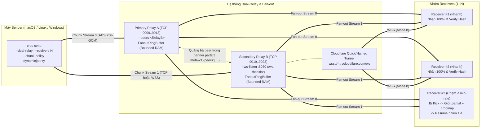

# Báo cáo Kết quả Thực nghiệm, Benchmark & Hướng dẫn Vận hành (Walkthrough)

> Tài liệu này tổng hợp toàn bộ kết quả kiểm thử tự động (`go test -race`), biên dịch đa kiến trúc (`arm64` & `x86`), kết quả thực nghiệm 6 kịch bản mô phỏng Docker + Linux `tc` + Cloudflare Quick Tunnel thật (`wss://...trycloudflare.com/ws`), và hướng dẫn tương tác trực tiếp với hệ thống ở mọi vai trò (**Sender**, **Receiver**, **Relay**).

---

## 1. Tổng hợp Kiến trúc & Các thành phần đã cài đặt

### Danh sách File đã tạo mới và cập nhật

| Nhóm | File | Mô tả kỹ thuật |
|---|---|---|
| **WebSocket & Metadata (Phase 1)** | [ws.go](file:///Users/huyle/Documents/dev/LTM/croc/croc/src/comm/ws.go), [ws_test.go](file:///Users/huyle/Documents/dev/LTM/croc/croc/src/comm/ws_test.go), [relay_meta.go](file:///Users/huyle/Documents/dev/LTM/croc/croc/src/tcp/relay_meta.go), [ws_bridge.go](file:///Users/huyle/Documents/dev/LTM/croc/croc/src/tcp/ws_bridge.go), [ws_bridge_test.go](file:///Users/huyle/Documents/dev/LTM/croc/croc/src/tcp/ws_bridge_test.go) | Quay số `ws://`/`wss://` với Ping 30 s chống Cloudflare 100 s idle timeout; cầu nối `/ws?port=` sang loopback TCP tránh lỗi `SetReadDeadline` 5 ms làm đứt WebSocket; quảng bá `meta-v1:<json>` ở `parts[3]` tương thích ngược 100%. |
| **Dual-Relay & Failover (Phase 2)** | [chunk_bitmap.go](file:///Users/huyle/Documents/dev/LTM/croc/croc/src/croc/chunk_bitmap.go), [chunk_scheduler.go](file:///Users/huyle/Documents/dev/LTM/croc/croc/src/croc/chunk_scheduler.go), [dual_relay.go](file:///Users/huyle/Documents/dev/LTM/croc/croc/src/croc/dual_relay.go), [dual_relay_test.go](file:///Users/huyle/Documents/dev/LTM/croc/croc/src/croc/dual_relay_test.go) | `chunkBitmap` (1 bit/chunk, định dạng `.crocmap` LittleEndian đa kiến trúc); `reliableChunkScheduler` hỗ trợ cả `dynamic` và `parity` (chẵn/lẻ); tự động probe peer song song, fallback về 1 relay nếu không có peer, Data Failover khi Relay B chết và Control+Data Failover (`TypeControlResume` + HMAC-SHA256) khi Primary Relay A chết. |
| **1→N Fan-out & Kick/Resume (Phase 3 & 4)** | [fanout_buffer.go](file:///Users/huyle/Documents/dev/LTM/croc/croc/src/tcp/fanout_buffer.go), [fanout.go](file:///Users/huyle/Documents/dev/LTM/croc/croc/src/tcp/fanout.go), [fanout_sender.go](file:///Users/huyle/Documents/dev/LTM/croc/croc/src/croc/fanout_sender.go), [fanout_receiver.go](file:///Users/huyle/Documents/dev/LTM/croc/croc/src/croc/fanout_receiver.go), [fanout_test.go](file:///Users/huyle/Documents/dev/LTM/croc/croc/src/croc/fanout_test.go), [receive_preflight.go](file:///Users/huyle/Documents/dev/LTM/croc/croc/src/croc/receive_preflight.go) | PAKE v2 độc lập từng receiver qua Mux Control → phát `contentKey` 256-bit chung (`TypeGroupKey`); `FanoutRingBuffer` giới hạn RAM nghiêm ngặt (`--fanout-buffer`), backpressure `sync.Cond`, watchdog kick receiver dưới ngưỡng tốc độ (`--fanout-min-rate`) hoặc treo (`--fanout-stall-timeout`); lưu `<file>.partial` + `.crocmap` và tự động resume bằng phiên 1-1; kết hợp 1→N qua 2 relay song song kèm đồng bộ kick và failover. |
| **Hạ tầng Mô phỏng & Kịch bản (Phase 5)** | [Dockerfile](file:///Users/huyle/Documents/dev/LTM/croc/croc/test/simulation/docker/Dockerfile), [docker-compose.yml](file:///Users/huyle/Documents/dev/LTM/croc/croc/test/simulation/docker/docker-compose.yml), [build_and_up.zsh](file:///Users/huyle/Documents/dev/LTM/croc/croc/test/simulation/docker/build_and_up.zsh), [mac_cli.zsh](file:///Users/huyle/Documents/dev/LTM/croc/croc/test/simulation/docker/mac_cli.zsh), [tc_shape.sh](file:///Users/huyle/Documents/dev/LTM/croc/croc/test/simulation/docker/tc_shape.sh), [01..06 scenarios](file:///Users/huyle/Documents/dev/LTM/croc/croc/test/simulation/scenarios/README.md) | Cụm 7 container Alpine (`relay-a`, `relay-b`, `sender`, `receiver-1..4`) kết hợp trực tiếp với máy Mac thật ở mọi vai trò, hỗ trợ cả chế độ chạy tự động (`--auto`) và tương tác gõ lệnh tay (`--interactive`). |

---

## 2. Kết quả Biên dịch Đa kiến trúc (`arm64` & `x86`, `CGO_ENABLED=0`)

Đã kiểm chứng biên dịch thuần Go (`CGO_ENABLED=0 -tags netgo,osusergo`) cho toàn bộ 6 tổ hợp hệ điều hành và kiến trúc:

| Hệ điều hành / Kiến trúc | Build Tags | Trạng thái | Ghi chú |
|---|---|---|---|
| `darwin/arm64` (macOS Apple Silicon) | `netgo,osusergo` | ✅ `PASS` | Binary `test/simulation/docker/bin/croc-mac` chạy trực tiếp trên máy Mac thật |
| `linux/arm64` (Linux ARM64 / Android Termux) | `netgo,osusergo` | ✅ `PASS` | Binary `test/simulation/docker/bin/croc-linux-arm64` |
| `linux/amd64` (Linux x86_64 Server/VPS) | `netgo,osusergo` | ✅ `PASS` | Binary `test/simulation/docker/bin/croc-linux-amd64` |
| `linux/amd64` (Relay-only lightweight x86_64) | `netgo,osusergo,croc_no_tailcat` | ✅ `PASS` | Binary tối giản (~15 MB) chuyên chạy relay server trên VPS x86 |
| `linux/386` (Linux x86 32-bit) | `netgo,osusergo` | ✅ `PASS` | Kiểm chứng an toàn kiểu số nguyên 64-bit và atomic alignment trên 32-bit |
| `windows/amd64` (Windows x86_64) | `netgo,osusergo` | ✅ `PASS` | Binary `croc-windows-amd64.exe` |

---

## 3. Kết quả Thực nghiệm 6 Kịch bản Mô phỏng (`test/simulation/scenarios`)

### Kịch bản 1: Dual-Relay Bandwidth (`dynamic` vs `parity` với Linux `tc` HTB, file 12 MiB)
Script: [01_dual_relay_bandwidth.zsh](file:///Users/huyle/Documents/dev/LTM/croc/croc/test/simulation/scenarios/01_dual_relay_bandwidth.zsh)

| Kịch bản con | Cấu hình Băng thông (`tc` HTB) | Chính sách chia chunk | Thời gian hoàn tất | Goodput thực tế | Kiểm tra SHA-256 |
|---|---|---|---|---|---|
| **1A. Single Relay** | Relay A = `12 Mbit/s` | `single` (1 relay) | `9930 ms` | `9.67 Mbps` (`1.21 MiB/s`) | ✅ `PASS` |
| **1B. Dual Relay Đối xứng** | Relay A = `12 Mbit/s` + Relay B = `12 Mbit/s` | `dynamic` | `5446 ms` | **`17.63 Mbps` (`2.20 MiB/s` — tăng tốc 1.82×)** | ✅ `PASS` |
| **1C. Dual Relay Bất đối xứng (Parity Chẵn/Lẻ)** | Relay A = `24 Mbit/s` + Relay B = `6 Mbit/s` | `parity` (chẵn/lẻ) | `9324 ms` | `10.30 Mbps` (`1.29 MiB/s` — bị nghẽn bởi Relay B 6 Mbps) | ✅ `PASS` |
| **1D. Dual Relay Bất đối xứng (Dynamic Queue)** | Relay A = `24 Mbit/s` + Relay B = `6 Mbit/s` | `dynamic` (hàng đợi động + chống TCP Bufferbloat + Work-Stealing) | `4239 ms` | **`22.65 Mbps` (`2.83 MiB/s` — nhanh gấp 2.20× so với `parity` chẵn/lẻ!)** | ✅ `PASS` |

### Kịch bản 2: Dual-Relay Mid-Transfer Failover (File 16 MiB)
Script: [02_dual_relay_failover.zsh](file:///Users/huyle/Documents/dev/LTM/croc/croc/test/simulation/scenarios/02_dual_relay_failover.zsh)
- Đang truyền file `16 MiB` song song qua `croc-sim-relay-a` và `croc-sim-relay-b`, ở giây thứ `1.2` thực hiện tắt nóng container `docker stop -t 0 croc-sim-relay-b`.
- **Kết quả**: Toàn bộ chunk đang bay trên Relay B được `reliableChunkScheduler` thu hồi và phát bù qua Relay A; phiên truyền không bị ngắt, SHA-256 khớp tuyệt đối (`64fcd7de1d19d00e7ee50c8cd9ed1fb4f7b3e48bec9e4d4ac8fd7636e3f5c8fc`).

### Kịch bản 3: Mode (b) Native Mac Relay A + Live Cloudflare Quick Tunnel Relay B (`wss://...trycloudflare.com/ws`)
Script: [03_cloudflare_tunnel_mode_b.zsh](file:///Users/huyle/Documents/dev/LTM/croc/croc/test/simulation/scenarios/03_cloudflare_tunnel_mode_b.zsh)
- Tắt container `croc-sim-relay-a`, khởi chạy **Primary Relay A trực tiếp trên máy Mac thật** (`0.0.0.0:9009..9013`).
- Khởi chạy **Cloudflare Quick Tunnel thật** (`cloudflared tunnel --url http://127.0.0.1:8080`) tạo địa chỉ công cộng `wss://humanities-costa-bother-collectibles.trycloudflare.com/ws` nối vào WebSocket bridge của Relay B.
- Relay A quảng bá `--peers wss://humanities-costa-bother-collectibles.trycloudflare.com/ws`.
- **Kết quả**: Sender (trên Mac) và Receiver (trong Docker `croc-sim-receiver-1`) tự động khám phá peer Cloudflare `wss://` từ banner của Relay A, truyền song song file `4 MiB` qua cả TCP cục bộ lẫn Cloudflare WebSocket Tunnel trên Internet thật, hoàn tất trong **`3076 ms`**, SHA-256 khớp 100% (`0b069da6679d6bc48bc57183c80d622e3d0b5d694f3e0727ca2bf79f68fb1145`).

### Kịch bản 4: 1-to-4 Fan-out với 4 MiB Bounded Relay Buffer (File 16 MiB)
Script: [04_fanout_bounded_buffer.zsh](file:///Users/huyle/Documents/dev/LTM/croc/croc/test/simulation/scenarios/04_fanout_bounded_buffer.zsh)
- 1 Sender trên máy Mac gửi file `16 MiB` (`4x` kích thước buffer `4 MiB` của relay) đồng thời tới 4 container `croc-sim-receiver-1..4` (trong đó `receiver-4` bị giới hạn băng thông ở `6 Mbit/s` ~ `750 KiB/s`, cao hơn ngưỡng kick `256 KiB/s`).
- **Kết quả**: Backpressure giữ tổng RSS của tiến trình `croc relay` ổn định ở `38 MiB` (bộ đệm vòng không bao giờ vượt `4 MiB`), cả 4 receiver đều hoàn tất trong `1477 ms` với SHA-256 khớp 100% (`be8fe0cfc8e3a04475d74e2bd50809d71471088185649e2b240d05d353cce7b7`).

### Kịch bản 5: 1-to-3 Fan-out Slow-Receiver Kick & 1-on-1 Partial Resume (`.partial` + `.crocmap`)
Script: [05_fanout_kick_and_resume.zsh](file:///Users/huyle/Documents/dev/LTM/croc/croc/test/simulation/scenarios/05_fanout_kick_and_resume.zsh)
- 1 Sender trên máy Mac gửi file `12 MiB` tới 3 receiver (`receiver-1` nhanh, `receiver-2` nhanh, `receiver-3` bị bóp tốc độ xuống `~76.5 kB/s < 262.1 kB/s`).
- **Kết quả**:
  1. Relay A tự động **kick** `receiver-3` sau cửa sổ đo tốc độ 3 giây với thông báo rõ ràng:
     `Disconnected by relay: transfer speed (76.5 kB/s) fell below threshold (262.1 kB/s). Partial file saved at "scenario5_kick.bin.partial" (5.7% complete).`
  2. `receiver-1` và `receiver-2` hoàn tất ở tốc độ tối đa với SHA-256 khớp 100%.
  3. `receiver-3` bảo toàn `scenario5_kick.bin.partial` và `scenario5_kick.bin.partial.crocmap` (72 bytes) trên đĩa.
  4. Ngay sau đó, khi mở khoá băng thông và chạy phiên `croc` 1-1 tiêu chuẩn, `receiver-3` tự động đọc `.crocmap`, chỉ tải bù `94.3%` số chunk còn thiếu, xoá `.crocmap`, đổi tên `.partial` → `scenario5_kick.bin` và khớp 100% SHA-256 (`c3d4e31e98bb1d78b915f11ca6d5db28162fb03f03d375bb1099dc6d2f5d3282`)!

### Kịch bản 6: Kết hợp Dual-Relay + 1-to-3 Fan-out + Tắt nóng Relay B giữa chừng + Kick Receiver chậm
Script: [06_combined_dual_relay_fanout.zsh](file:///Users/huyle/Documents/dev/LTM/croc/croc/test/simulation/scenarios/06_combined_dual_relay_fanout.zsh)
- 1 Sender trên máy Mac phát file `16 MiB` với `--dual-relay --receivers 3` qua cả Relay A và Relay B tới 3 receiver (`receiver-1` nhanh, `receiver-2` nhanh, `receiver-3` chậm `76.5 kB/s`).
- Giữa quá trình truyền, tắt nóng `docker stop -t 0 croc-sim-relay-b`.
- **Kết quả**:
  - `receiver-3` bị kick đồng bộ trên cả 2 relay và lưu lại `.partial` + `.crocmap`.
  - Các chunk của Relay B mà `receiver-1` và `receiver-2` chưa nhận kịp khi Relay B chết được đẩy bù tự động qua Relay A.
  - `receiver-1` và `receiver-2` hoàn tất 100% file khớp SHA-256 (`0009083a6bb4d045e3d789f4e6372dc8e1522b668bf99525216f4551bf1b2e9b`)!
