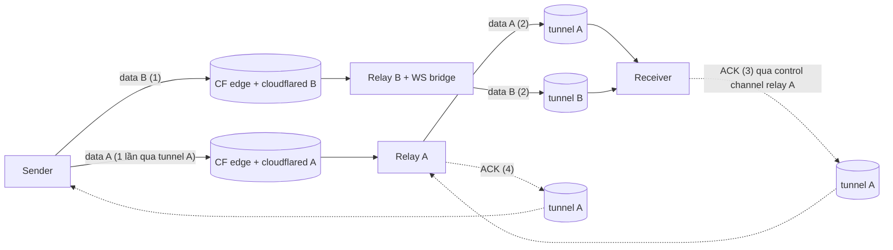

# Rà soát Dual-Relay (parity & dynamic): Lỗi, Hiệu năng qua Cloudflare Tunnel, Public Relay và Bộ nhớ Relay

> Phạm vi: chế độ 2 relay (`--dual-relay` / `--relay2`) ở cả hai chính sách `parity` và `dynamic`, khi relay đi qua Cloudflare Quick Tunnel (`wss://*.trycloudflare.com/ws`).
> Câu hỏi xuất phát: khi test thật qua Cloudflare, `dynamic` chỉ đạt **~12 MB/s (đỉnh 16)** trong khi `parity` đạt **~16 MB/s (đỉnh 25)**.
> Ngày rà soát: 2026-11-24. Nền: commit `58a317db` (`fix: bandwidth`).

---

## 1. Tóm tắt

| Câu hỏi | Kết luận |
|---|---|
| Vì sao `dynamic` chậm hơn `parity` qua Cloudflare? | Cửa sổ in-flight của `dynamic` bị chặn ở **256 chunk = 8 MiB mỗi relay** và được tính từ **một RTT dùng chung cho cả 2 relay**. Qua tunnel, vòng ACK đi qua tunnel 4 lần nên RTT ACK ~0.6–1.5 s, vậy trần là 8 MiB / RTT ≈ 5–13 MB/s mỗi relay. `parity` không có cửa sổ nên không bị chặn. **Đã tái hiện bằng giả lập (dynamic 19 vs parity 30 MB/s) và đã sửa (dynamic 30 MB/s).** |
| Còn chỗ cải thiện tốc độ không? | Có. Đã sửa 12 lỗi/điểm nghẽn (mục 3), gồm xử lý ACK O(N²) (5.78 s → 2.55 ms CPU cho file 2 GiB) và 2 WebSocket message cho mỗi chunk. Phần còn lại phụ thuộc hạ tầng: cấu hình tunnel, giao thức `cloudflared` và đặt relay A ngoài tunnel (mục 6). |
| Có bị gửi lên public relay của croc không? | **Không**, khi cả hai phía đều đặt `--relay` (hoặc `CROC_RELAY`). Relay phụ chỉ lấy từ `--relay2` hoặc `--peers` của relay A, không bao giờ là public relay. Tuy nhiên có **một kết nối ra ngoài ngoài ý muốn**: với file ≥128 MiB và `--transport auto` (mặc định), sender vẫn tải DERP map và thăm dò DERP của **Tailscale** dù đã bật `--dual-relay`. **Đã sửa.** Chi tiết các đường ra Internet khác ở mục 5. |
| Bộ nhớ relay? | Ở chế độ 1-1, relay chỉ là "ống" `io.Copy`. Bộ nhớ user-space **không phụ thuộc parity/dynamic**: đo được relay A ~22 MiB, relay B (có WS bridge) ~25 MiB working set ở cả hai chế độ. Khác biệt nằm ở **kernel socket buffer**: parity không giới hạn in-flight nên làm đầy buffer của chặng chậm, còn dynamic bị chặn bởi cửa sổ. Chi tiết ở mục 7. |

---

## 2. Phương pháp

1. **Đọc mã nguồn** toàn bộ đường dual-relay: [chunk_scheduler.go](../src/croc/chunk_scheduler.go), [chunk_bitmap.go](../src/croc/chunk_bitmap.go), [dual_relay.go](../src/croc/dual_relay.go), đường nhận trong [croc.go](../src/croc/croc.go) (`receiveDataWithRelay`), [comm.go](../src/comm/comm.go), [ws.go](../src/comm/ws.go), [ws_bridge.go](../src/tcp/ws_bridge.go), pipe relay trong [tcp.go](../src/tcp/tcp.go), chọn relay trong [cli.go](../src/cli/cli.go), Tailcat trong [tailcat_negotiation.go](../src/croc/tailcat_negotiation.go).
2. **Tài liệu chính thức mới nhất**:
   - Cloudflare Quick Tunnels: <https://developers.cloudflare.com/cloudflare-one/networks/connectors/cloudflare-tunnel/do-more-with-tunnels/trycloudflare/>
   - Cloudflare WebSockets: <https://developers.cloudflare.com/network/websockets/>
   - Tham số `cloudflared` (`--protocol`): <https://developers.cloudflare.com/cloudflare-one/networks/connectors/cloudflare-tunnel/configure-tunnels/cloudflared-parameters/run-parameters/>
   - croc upstream README và release mới nhất **v11.6.6** (21/11/2026): <https://github.com/schollz/croc>, <https://github.com/schollz/croc/releases>
3. **Giả lập tunnel có thể tái lập** trên Windows (không gửi dữ liệu ra Internet): một proxy TCP tự viết (`netem`, chỉ dùng thư viện chuẩn của Go) đặt trước mỗi relay để tạo:
   - độ trễ một chiều cố định,
   - băng thông giới hạn chung cho mọi kết nối theo từng chiều,
   - hàng đợi sâu (bufferbloat): hoặc riêng từng kết nối, hoặc **một FIFO chung** (ACK phải xếp hàng sau dữ liệu, giống điểm nghẽn thật).

   Relay B chạy sau proxy với WS bridge thật (`--ws-listen`). Client nối `ws://.../ws` (cùng đường code với `wss://` qua Cloudflare, chỉ khác TLS). File thử 256 MiB ngẫu nhiên; mọi lần chạy đều kiểm tra SHA-256.
4. **Đo bộ nhớ**: lấy mẫu `WorkingSet64` / `PrivateMemorySize64` của từng tiến trình relay mỗi 200 ms, ghi lại giá trị đỉnh.

> **Giới hạn:** giả lập không thay được tunnel Cloudflare thật (QUIC của `cloudflared`, định tuyến edge, mất gói). Tốc độ tuyệt đối sẽ khác, nhưng **cơ chế** gây chậm đã được tái hiện đúng chiều (parity > dynamic). Cách kiểm chứng trên Cloudflare thật ở mục 8.

---

## 3. Lỗi tìm thấy và trạng thái

Mức độ: **Cao** = ảnh hưởng trực tiếp tốc độ hoặc độ tin cậy; **TB** = ảnh hưởng trong điều kiện cụ thể; **Thấp** = vệ sinh mã / quan sát.

| # | Mức | Chế độ | Vấn đề | Hệ quả | Trạng thái |
|---|---|---|---|---|---|
| B1 | **Cao** | dynamic | `smoothedRTT` **dùng chung** cho cả 2 relay ([chunk_scheduler.go](../src/croc/chunk_scheduler.go), bản cũ `dynamicInFlightLimitLocked`). | Relay nhanh (nhiều mẫu hơn) kéo RTT trung bình xuống, làm cửa sổ của relay qua tunnel quá nhỏ. | Đã sửa: `relayEstimator` riêng cho từng relay (minRTT, sRTT, delivery rate, window). |
| B2 | **Cao** | dynamic | Cửa sổ = `2 × RTT_ms` chunk, **trần 256 chunk (8 MiB)**. | Thông lượng mỗi relay ≤ 8 MiB / RTT_ACK. Với RTT ACK 0.7 s là ~12 MB/s, khớp với số đo thật. **Đây là nguyên nhân chính.** | Đã sửa: `window = rate × max(1 s, 2·minRTT, sRTT)`, sàn 1 MiB, trần 64 MiB. Hạng `sRTT` giữ cửa sổ trung tính (không co rút theo vòng xoáy) khi RTT bị phồng do hàng đợi trên đường của relay kia. |
| B3 | TB | dynamic | Mẫu RTT tính từ lúc `Claim` (trước khi đọc file/mã hoá/gửi) và **tính cả bản truyền lại**. | RTT sai lệch, vi phạm thuật toán Karn. | Đã sửa: đóng dấu thời gian khi `Send` xong; bỏ mẫu của chunk truyền lại hoặc bị steal. |
| B4 | **Cao** | cả hai | `ApplyAck` quét lại từ chunk 0 tới `CumChunk` **ở mỗi ACK**, tức O(N²) theo kích thước file, và chạy trong lúc giữ khoá scheduler. | Benchmark file 2 GiB (16 384 ACK): **5.78 s CPU** trong khoá. Chi phí tăng theo bình phương, nên file 10 GiB tốn khoảng 145 s, làm chặn `Claim` và thông lượng giảm dần theo thời gian. | Đã sửa: con trỏ `cumApplied`, chỉ duyệt phần mới: **2.55 ms** (~2000×). |
| B5 | Thấp | dynamic | `inFlightForRelayLocked` duyệt toàn map in-flight ở mỗi `Claim`. | O(window) cho mỗi chunk. | Đã sửa: bộ đếm O(1) cho từng relay. |
| B6 | TB | dynamic | Receiver chỉ nhớ **tối đa 256** chunk đến không theo thứ tự giữa hai ACK; phần vượt bị **bỏ im lặng** ([chunk_bitmap.go](../src/croc/chunk_bitmap.go)). | Các chunk đó nằm "in-flight" mãi ở sender cho tới khi frontier tích luỹ vượt qua, làm chiếm cửa sổ của relay nhanh (head-of-line blocking sau relay chậm). | Đã sửa: trần 4096, khi tràn thì quét bitmap để báo đủ. |
| B7 | TB | dynamic | Steal ở đuôi lấy chunk **cũ nhất** của relay kia bất kể sắp tới nơi; relay chậm cũng steal chunk mới của relay nhanh; chunk bị steal giữ `connID` cũ. | Truyền trùng vô ích. Bản sửa đầu tiên của mình đo được 669 chunk trùng (8%). | Đã sửa: chỉ steal khi `sRTT_owner − age > sRTT_stealer` hoặc chunk quá hạn (> 2·sRTT_owner); cập nhật `connID`. Kịch bản RTT cao: **75 chunk trùng (0.9%)**. |
| B8 | **Cao** (với Cloudflare) | cả hai | **Một** kết nối dữ liệu đứt là cả relay bị coi là chết: receiver luôn báo `failedRelay=slot` ([dual_relay.go](../src/croc/dual_relay.go) `onReceiverDataConnError`); sender gọi `markRelayDead` ngay ở lỗi `Send` đầu tiên. | Cloudflare có thể ngắt WebSocket khi deploy ("may restart servers, which terminates WebSockets connections"). Khi đó phần còn lại của file chỉ chạy trên 1 relay. | Đã sửa: `RequeueConn(relay, conn)` chỉ đưa chunk của kết nối đó vào hàng đợi lại; relay chỉ bị coi là chết khi hết kết nối. |
| B9 | **Cao** (với Cloudflare) | cả hai | Probe relay phụ **2 s**, kết nối **5 s**, và nếu 1/4 kênh dữ liệu lỗi thì bỏ cả relay B. Thông báo fallback ở mức `Info`, **bị ẩn** vì client đặt log ở mức `warn` ([croc.go:93](../src/croc/croc.go#L93)). | Qua tunnel (DNS + TCP + TLS + upgrade + chặng `cloudflared` + handshake relay), 2–5 s dễ bị vượt, khiến croc **lặng lẽ chạy 1 relay**. Kết quả đo khi đó không phản ánh dual-relay. | Đã sửa: timeout cho `ws(s)://` là probe 6 s, kết nối 20 s; mọi fallback in ra `[warn] dual-relay: ... continuing with a single relay`; lỗi probe ghi rõ địa chỉ và nguyên nhân. |
| B10 | TB | cả hai | `comm.Write` dùng `net.Buffers{header, payload}.WriteTo`. Trên `websocket.NetConn` (không phải `*net.TCPConn`) lệnh này thành **2 lần Write = 2 WebSocket message** cho mỗi chunk (8 byte + 32 KiB), mỗi lần có frame, flush và TLS record riêng. | Gấp đôi số message/packet nhỏ qua tunnel. Test chứng minh trên code gốc: message đầu chỉ có 8 byte. | Đã sửa: gộp header và payload thành 1 message (bộ đệm dùng lại từ `sync.Pool`). |
| B11 | TB (quyền riêng tư) | cả hai | `startTailcatPreparation` không kiểm tra dual-relay: với file ≥128 MiB và `--transport auto`, sender **tải DERP map và thăm dò DERP của Tailscale**, dù Tailcat không bao giờ được chọn khi bật dual-relay. | Kết nối ra hạ tầng công cộng ngoài ý muốn (lộ IP, tốn thời gian khởi động). | Đã sửa và có test. |
| B12 | TB | cả hai (sender) | Scheduler tạo `map[int64]int` offset→index cho **mỗi chunk**. | File 10 GiB: **23.4 MB / 1068 lần cấp phát** khi khởi tạo. | Đã sửa: tìm nhị phân trên offset đã sắp xếp, cấp phát trước: **3.3 MB / 7 lần cấp phát**. |

### Phát hiện chưa sửa (ghi nhận)

| # | Ghi chú |
|---|---|
| N1 | `parity` không steal ở đuôi (theo thiết kế chia chẵn/lẻ cứng), nên thông lượng parity ≈ 2 × min(A, B), và relay nhanh phải chờ relay chậm ở cuối file. Watchdog của parity cũng đưa chunk vào lại hàng đợi **trên chính relay đó**. |
| N2 | ACK được gửi **đồng bộ** từ goroutine nhận dữ liệu qua control channel của relay A. Nếu control path tắc (tunnel A bị bufferbloat), goroutine nhận dữ liệu bị chặn theo. Đề xuất: một goroutine gửi ACK riêng, gộp ACK. |
| N3 | `processChunkAck` đọc `FilesToTransferCurrentNum` không khoá (data race lành tính). |
| N4 | `ws_bridge.go` dùng `InsecureSkipVerify: true` (bỏ kiểm tra Origin). Relay vẫn yêu cầu mật khẩu nên rủi ro thấp, nhưng nên kiểm tra Origin nếu public bridge lâu dài. |
| N5 | `TestWrongPassword` (`src/tcp`) chập chờn trên Windows **ngay cả trên code gốc** (2/4 lần fail): RST đến trước thông báo "bad password". Không liên quan đến thay đổi này. |
| N6 | Không chạy được `go test -race` trên máy này (Windows không có gcc, Docker daemon đang tắt). Mọi thay đổi trạng thái scheduler đều nằm dưới `s.mu`, bitmap dưới `b.mu`, ghi WS dưới `writeMu`. Nên chạy `-race` trên Linux/macOS trước khi phát hành. |

---

## 4. Vì sao Cloudflare Tunnel làm `dynamic` chậm: phân tích đường đi



- Mỗi chunk của relay B có vòng phản hồi = 2 lần qua tunnel B + 2 lần qua tunnel A (vì ACK luôn đi qua **control channel của relay A**).
- Hướng "relay A → client" của tunnel A chở **cả dữ liệu tới receiver lẫn ACK tới sender**, nên ACK xếp hàng sau dữ liệu (bufferbloat) và RTT ACK phồng lên mức 0.7–1.5 s (đo được trong giả lập: `srtt=1.0–1.5 s`).
- Bản cũ: trần 8 MiB mỗi relay, nên thông lượng ≤ 8 MiB / 0.7 s ≈ **12 MB/s**, đúng con số bạn đo được với `dynamic`. `parity` không có cửa sổ nên chỉ bị chặn bởi băng thông.
- Ngoài ra `--relay` của sender và receiver cũng có thể đi qua tunnel, nên **băng thông uplink của máy chạy relay bị dùng 2 lần** (vào và ra).

---

## 5. Kiểm tra "có gửi lên public relay của croc không"

Tóm tắt các đường code có thể kết nối ra Internet (ngoài relay A/B của bạn):

| Đường đi | Khi nào xảy ra | Dữ liệu file có đi qua không? | Khuyến nghị |
|---|---|---|---|
| Public relay croc (`publicrelay.Relays()`, `croc.schollz.com`, `croc6.schollz.com`) | Chỉ khi **không** đặt `--relay`, `--relay6`, `CROC_RELAY` (hàm `usesPublicRelay` trong [cli.go](../src/cli/cli.go)). Khi đặt `--relay`, `RelayAddress6` bị xoá nên không dùng IPv6 public. | Không. Nếu receiver quên `--relay`, nó chỉ thử handshake ở public relay rồi treo, vì sender không ở đó. | Luôn truyền `--relay` cho **cả hai phía**. |
| Relay phụ (B) | Chỉ từ `--relay2` / `CROC_RELAY2` hoặc `--peers` của relay A (`candidateSecondaryRelays`). | Chỉ qua relay của bạn. | — |
| Tailscale DERP (Tailcat) | Không bật dual-relay, `--transport auto`, file ≥128 MiB: **dữ liệu có thể đi qua DERP/P2P** thay vì relay. Có bật dual-relay: Tailcat bị tắt nhưng **bản cũ vẫn tải DERP map** (B11). | Bản cũ: không gửi dữ liệu, chỉ có kết nối ra ngoài. Bản mới: không kết nối. | Khi đo so sánh single-relay, thêm `--transport relay`, nếu không thì phép đo "single" có thể đi DERP. |
| Local relay + multicast LAN | Mặc định (không có `--no-local`): sender mở relay cục bộ và broadcast trong LAN. | Nếu receiver cùng LAN tìm thấy, dữ liệu **bỏ qua relay A/B hoàn toàn**. | Dùng `--no-local` ở cả hai phía khi test. |
| `ipv4.icanhazip.com` | Chỉ khi dùng `--debug`. | Không. | Dùng `LOGGER=info` hoặc `LOGGER=debug` thay cho `--debug` để xem log mà không gọi ra ngoài. |
| GitHub (kiểm tra cập nhật) | Tối đa 1 lần/24 h khi send/receive. | Không. | `--no-update-check` hoặc `CROC_NO_UPDATE_CHECK=1`. |

Hiện tượng `Sending (->2402:800:...)` trong smoke test **không** phải do public relay: `preferredPublicIP` lấy địa chỉ IPv6 global từ card mạng của chính máy khi relay trả về `127.0.0.1` ([terminal_display.go](../src/croc/terminal_display.go)).

> Kiểm chứng thực nghiệm (theo dõi socket của tiến trình) đã chuẩn bị nhưng **chưa chạy** vì yêu cầu dừng test. Các kết luận ở bảng trên dựa trên đọc mã nguồn; riêng B11 có unit test `TestDualRelaySenderSkipsTailcatPreparation`.

---

## 6. Kết quả hiệu năng (giả lập)

Tốc độ là tốc độ pha truyền dữ liệu, đọc từ thanh tiến trình của receiver (MB/s, file 256 MiB, SHA-256 khớp ở mọi lần chạy hoàn tất). `A`/`B` = băng thông mỗi chiều / độ trễ một chiều của proxy trước relay A/B.

| Kịch bản | Mô tả | Gốc dynamic | Gốc parity | **Sửa dynamic** | Sửa parity | single |
|---|---|---|---|---|---|---|
| S1 nhẹ | A 12 MB/s 30 ms, B 10 MB/s 60 ms, hàng đợi 2 MiB/kết nối | 21 | 18 | **22** | 17 | 11–12 |
| S2 hàng đợi kiểu CF | A 15 MB/s 40 ms, B 12 MB/s 150 ms, hàng đợi 4/8 MiB/kết nối | 25 | 21 | **24** | 21 | 15 |
| S3 FIFO bufferbloat | A 12 MB/s 60 ms, B 10 MB/s 120 ms, 1 FIFO 8 MiB/chiều | 22 | 16 | **22** | 16 | 12 |
| **S4 RTT cao (giống tình huống của bạn)** | A/B 15 MB/s, 150/200 ms, FIFO 8 MiB | **19** | **30** | **30** | 30 | — |

- S4 tái hiện đúng hiện tượng thực tế (parity > dynamic). Sau sửa, dynamic đạt mức lý tưởng (2 × 15 MB/s).
- S1–S3: bản sửa **không làm chậm** các trường hợp vốn đã tốt (chênh ±1 MB/s, trong biên độ nhiễu).
- Thống kê bản sửa ở S4 (`dual-relay stats`): `relayA=4174 relayB=4093 retransmissions=75 window=928/684 minRTT=812ms/737ms srtt=1.008s/1.174s rate=18.7/15.1MB/s`.
- **Chưa chạy** (do dừng test): S5 bất đối xứng LAN (3 MB/s + 0.75 MB/s, tương tự kịch bản 1D cũ), và S3-single của bản sửa bị ngắt giữa chừng. Nên chạy lại S5 để xác nhận cửa sổ sàn 1 MiB không làm đuôi chậm hơn bản cũ (16 chunk).

### Khuyến nghị hạ tầng (ngoài code)

1. **Đặt relay A ngoài tunnel** (VPS hoặc mở port): ACK luôn đi qua relay A, nên RTT của nó quyết định độ phản hồi của cả hai relay.
2. Thử `cloudflared tunnel --protocol http2 --url ...` và so với mặc định `auto`/QUIC. Issue chính thức [cloudflare/cloudflared#895](https://github.com/cloudflare/cloudflared/issues/895) ghi nhận QUIC chậm hơn http2 trong một số mạng; cổng 7844 UDP/TCP phải mở.
3. Quick Tunnel: **giới hạn 200 request in-flight** (mỗi WebSocket là 1 request; dual-relay dùng 5 WS cho mỗi phía trên relay B, fan-out N receiver dùng khoảng 5(N+1)), **không cam kết uptime**, hostname đổi mỗi lần chạy. Tài liệu Cloudflare không công bố giới hạn băng thông. Khi dùng lâu dài nên chuyển sang Named Tunnel.
4. Cloudflare đóng WebSocket khi không có dữ liệu một thời gian (tài liệu không nêu con số; croc đã ping 30 s) và khi deploy. Bản sửa B8 giúp không mất relay khi một WS bị đóng.

---

## 7. Phân tích bộ nhớ từng relay (parity vs dynamic)

### 7.1 Số đo (Windows, đỉnh trong lần truyền 256 MiB)

| Kịch bản | Relay A WS / Private | Relay B (WS bridge) WS / Private |
|---|---|---|
| dynamic (gốc và sửa, S1–S4) | 21.3–22.7 MiB / 53.8–55.6 MiB | 24.6–25.6 MiB / 56.3–58.5 MiB |
| parity (gốc và sửa, S1–S4) | 21.7–22.7 MiB / 54.1–55.6 MiB | 24.7–25.9 MiB / 56.3–58.5 MiB |
| single (relay B rảnh, chỉ lắng nghe) | ~22 MiB / ~55 MiB | 16.4–16.6 MiB / 49.5–49.9 MiB |

**Kết luận:** chênh lệch giữa parity và dynamic **< 1 MiB**, trong biên độ nhiễu. Một phiên dual-relay làm relay B tăng ~8–9 MiB working set so với lúc rảnh. "Private" ~55 MiB chủ yếu là vùng nhớ Go runtime đặt trước (arena), không phải dữ liệu đang giữ.

### 7.2 Mô hình bộ nhớ theo mã nguồn

**Relay A (TCP thuần), mỗi phiên dual-relay = 1 phòng control + 4 phòng data:**
- Mỗi phòng sau khi ghép đôi là `pipeWithProtocol`: 2 goroutine `io.Copy`.
  - Linux: `TCPConn.ReadFrom` dùng `splice(2)`, **không có buffer user-space** (pipe kernel lấy từ pool).
  - Windows: `io.Copy` cấp **32 KiB mỗi chiều**, tức khoảng 64 KiB + 2 stack goroutine mỗi phòng.
- Tổng user-space mỗi phiên: ~0.3–0.5 MiB. **Không phụ thuộc policy**, vì relay không đọc nội dung chunk.

**Relay B (`--ws-listen`), mỗi stream WebSocket** (5 stream mỗi phía = 10 stream mỗi phiên):
- Bridge: 2 × 64 KiB buffer `io.CopyBuffer`, bufio đọc/ghi 4 KiB của kết nối HTTP bị hijack, goroutine HTTP + goroutine ping + 2 goroutine copy.
- Thêm 1 cặp socket loopback bridge → cổng relay, kèm 1 phòng relay như trên.
- Tổng khoảng 170–250 KiB mỗi stream, tức **~2–3 MiB mỗi phiên**. Khớp với chênh ~3 MiB giữa relay B và A.
- Relay B không giữ TLS (`cloudflared` kết thúc TLS), nên không tốn bộ nhớ TLS.

**Kernel socket buffer (không nằm trong working set của tiến trình), đây là nơi parity và dynamic khác nhau:**
- **parity**: không có cửa sổ in-flight. Sender đẩy tới khi TCP chặn, nên buffer gửi/nhận trên **chặng chậm hơn** (thường là hướng relay → tunnel) bị lấp đầy tới mức autotune (Linux mặc định tới 4 MiB `wmem` / 6 MiB `rmem` mỗi socket). Relay B có 2–4 socket cho mỗi stream (ngoài + loopback), nên trường hợp xấu là hàng chục MiB kernel cho mỗi phiên.
- **dynamic** (bản sửa): dữ liệu chưa ACK của mỗi relay ≤ `rate × max(1 s, 2·minRTT, sRTT)`. Với 15 MB/s và RTT 0.75 s là ~20–30 MiB, **chia ra** socket của sender, tunnel, relay và receiver. Bản cũ giới hạn 8 MiB, nhưng chính giới hạn đó làm giảm thông lượng.
- `cloudflared` là tiến trình riêng, có buffer QUIC/HTTP2 riêng (chưa đo).

**Fan-out (`--receivers N`)** là chế độ duy nhất mà relay **giữ dữ liệu trong user-space**: ring buffer `--fanout-buffer` (mặc định 16 MiB mỗi phòng), tổng bị chặn bởi `--fanout-max-memory` (mặc định 256 MiB). Đây là tham số cần chỉnh nếu chạy relay trên máy ít RAM.

### 7.3 Bộ nhớ phía sender (scheduler)

| File | Gốc | Sửa |
|---|---|---|
| 10 GiB (327 680 chunk) | 23.4 MB, 1068 lần cấp phát, 24.5 ms | **3.3 MB, 7 lần cấp phát, 1.5 ms** |

Map in-flight bị chặn bởi cửa sổ (≤ 2048 entry mỗi relay). Chunk đang in-flight **không** được giữ trong RAM: khi truyền lại, sender đọc lại từ đĩa.

---

## 8. Cách kiểm chứng trên Cloudflare thật

Bật log `info` để thấy cảnh báo fallback và dòng thống kê mà không gọi `icanhazip` như `--debug`:

```bash
# Máy relay B (sau NAT):
croc --pass PASS relay --host 0.0.0.0 --ports 9019,9020,9021,9022,9023 --ws-listen 127.0.0.1:8080
cloudflared tunnel --url http://127.0.0.1:8080            # thử thêm: --protocol http2

# Máy relay A (tốt nhất là IP public, không qua tunnel):
croc --pass PASS relay --host 0.0.0.0 --ports 9009,9010,9011,9012,9013 --peers wss://<ten>.trycloudflare.com/ws

# Sender:
LOGGER=info CROC_SECRET=<code> croc --no-local --no-update-check --pass PASS --relay <A>:9009 \
  send --transport relay --dual-relay --chunk-policy dynamic <file>

# Receiver:
LOGGER=info CROC_SECRET=<code> croc --no-local --no-update-check --yes --pass PASS --relay <A>:9009
```

Trên PowerShell: `$env:LOGGER='info'; $env:CROC_SECRET='<code>'` trước lệnh.

Dấu hiệu cần xem ở log sender:
- `[warn] dual-relay: ... continuing with a single relay`: relay B **không được dùng**. Lần đo đó không hợp lệ.
- `[info] dual-relay: active across primary relay and secondary relay ...`: dual-relay đã bật.
- `[info] dual-relay stats: policy=... relayA=… relayB=… retransmissions=… window=… minRTT=… srtt=… rate=…`: phân bố chunk, số lần truyền lại, cửa sổ và RTT của **từng relay**. Nếu `window` của một relay đứng ở `2048` (64 MiB) mà tốc độ vẫn thấp, điểm nghẽn là tunnel/băng thông chứ không phải scheduler.

---

## 9. Tệp thay đổi

| Tệp | Thay đổi |
|---|---|
| [src/croc/chunk_scheduler.go](../src/croc/chunk_scheduler.go) | Ước lượng riêng cho từng relay, cửa sổ mới, bộ đếm in-flight O(1), ACK tích luỹ tăng dần, tìm nhị phân offset, steal có điều kiện, `RequeueConn`, `Stats`, Karn. |
| [src/croc/chunk_bitmap.go](../src/croc/chunk_bitmap.go) | Không bỏ ACK chọn lọc khi có > 256 chunk đến không theo thứ tự. |
| [src/croc/dual_relay.go](../src/croc/dual_relay.go) | Timeout riêng cho WS; cảnh báo fallback ở mức `warn`; chỉ coi relay là chết khi hết kết nối; log `dual-relay stats`. |
| [src/comm/comm.go](../src/comm/comm.go) | 1 WebSocket message cho mỗi frame croc. |
| [src/croc/tailcat_negotiation.go](../src/croc/tailcat_negotiation.go) | Không chuẩn bị Tailcat/DERP khi bật dual-relay. |
| [src/croc/chunk_scheduler_window_test.go](../src/croc/chunk_scheduler_window_test.go), [src/comm/ws_frame_test.go](../src/comm/ws_frame_test.go) | 9 unit test và 1 benchmark mới cho các sửa đổi trên. |

Kiểm thử đã chạy (không có `-race`, xem N6): toàn bộ test dual-relay, fan-out, Tailcat, staged transport trong `src/croc`; `src/comm`; `src/tcp` (trừ `TestWrongPassword`, vốn chập chờn trên Windows, xem N5).
